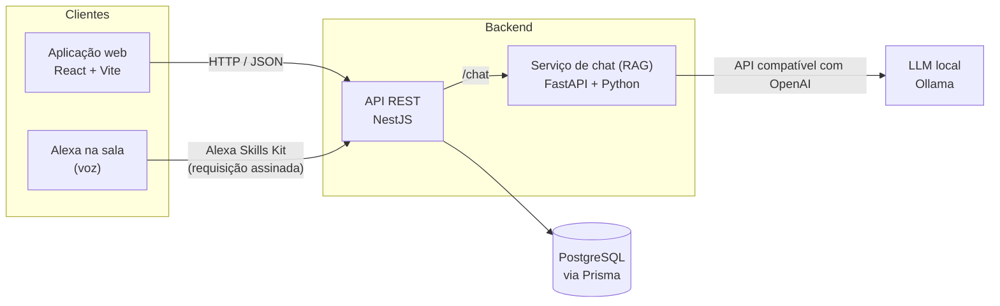

<div align="center">

# PROJETO PAUSA

**Agenda de massoterapia corporativa, acessível de ponta a ponta**

Reserva de sessões, lista de espera, check-in por QR Code, chatbot, painel de gestão e integração com a Alexa,
pensados para que massoterapeutas com deficiência visual trabalhem com autonomia.


</div>

---

## Sumário

- [Sobre o projeto](#sobre-o-projeto)
- [Como funciona na prática](#como-funciona-na-prática)
- [Arquitetura](#arquitetura)
- [Tecnologias e o papel de cada uma](#tecnologias-e-o-papel-de-cada-uma)
- [Acessibilidade](#acessibilidade)
- [Estrutura do repositório](#estrutura-do-repositório)
- [Como rodar localmente](#como-rodar-localmente)
- [Testes e qualidade](#testes-e-qualidade)
- [Documentação](#documentação)

---

## Sobre o projeto

O Pausa nasceu no **Desafio de Inovação do Programa de Estágio Semantix 2026**, a partir da pergunta:

> Como a tecnologia pode promover inclusão profissional e autonomia para massoterapeutas com deficiência visual,
> eliminando o atrito operacional e elevando o bem-estar corporativo?

A empresa oferece sessões de massoterapia aos colaboradores, atendidas por massoterapeutas com deficiência visual.
Nas entrevistas, o problema apareceu dos dois lados: o terapeuta não sabia quem era o próximo atendimento e ficava
parado quando alguém faltava, e o colaborador enfrentava agenda confusa, fila e falta de retorno. A causa era a
mesma: toda a informação da agenda passava por uma pessoa e circulava por canais visuais.

O Pausa corrige esse fluxo de informação. Os princípios que guiaram o projeto:

- **Modelo social da deficiência:** a barreira está no processo, não na pessoa.
- **Paridade de informação:** o terapeuta sabe o mesmo que a gestão, no mesmo momento.
- **Terapeuta protagonista:** ele consulta e age sobre a própria agenda, pela web ou por voz.
- **Resolver para um, estender para muitos:** o que é desenhado para o terapeuta cego serve a todos.

**Métrica principal:** o terapeuta consegue passar um dia inteiro de trabalho sem pedir informação a ninguém.

---

## Como funciona na prática

O sistema tem três fluxos principais, cada um com a sua tela.

### Colaborador

| Funcionalidade | Como funciona |
| --- | --- |
| **Reserva de massagens** | Escolhe unidade, massoterapeuta e dia; cada dia mostra as vagas livres e a reserva sai em poucos cliques. |
| **Andamento e cancelamento** | Acompanha a situação de cada reserva e cancela de forma simples, com confirmação. |
| **Lista de espera** | Sem horário satisfatório, entra na fila; se uma vaga abrir, a oferta aparece para ele. |
| **Check-in por QR Code** | No dia da sessão, lê o QR Code da sala para confirmar presença, o que dá rastreabilidade ao atendimento. |
| **Chatbot** | Tira dúvidas sobre o sistema e o benefício num só lugar, com respostas baseadas na documentação do Pausa (RAG). |
| **Pesquisa de satisfação** | Depois da sessão, responde a uma pesquisa curta que ajuda a identificar melhorias. |

### Massoterapeuta

Tela de apoio, além da Alexa, com visibilidade e autonomia sobre as sessões: o atendimento atual, a agenda do dia e os
avisos (novas reservas, cancelamentos, atrasos). Na sala, a **Alexa** responde por voz quem é o próximo atendimento e
permite iniciar e finalizar sessões sem tocar em tela.

### Gestão (RH e suporte)

| Funcionalidade | Como funciona |
| --- | --- |
| **Usuários** | Busca, cadastro e atualização do acesso de colaboradores, terapeutas e gestores. |
| **Unidades e salas** | Cadastro de unidades e salas, com geração e renovação do QR Code de check-in. |
| **Agendas e horários** | Planejamento da agenda de cada terapeuta, horários sem atendimento e regras de negócio (duração, limites, antecedência). |
| **Conectar a Alexa** | Geração de códigos de pareamento para ligar cada dispositivo a um terapeuta. |
| **Auditoria** | Histórico de alterações nos agendamentos: o que mudou, quando e por quem. |
| **Relatórios** | Volume de atendimentos e métricas gerais (turno, dia e horário mais procurados, cancelamentos) e o resultado das pesquisas de satisfação, com gráficos acessíveis. |

---

## Arquitetura



- **Frontend** em React, organizado por funcionalidade (`features/booking`, `features/hr`, `features/check-in`...).
- **API** em NestJS, com um módulo por domínio: agendamentos, lista de espera, presença, salas, agendas, regras de negócio,
  notificações, auditoria, relatórios, pesquisa, chat e Alexa.
- **Banco** PostgreSQL modelado com Prisma (usuários, unidades, salas, terapeutas, horários, bloqueios, agendamentos,
  lista de espera, notificações, eventos de auditoria, dispositivos Alexa, regras e respostas de pesquisa).
- **Notificações** geradas por tarefa agendada a cada minuto (`@nestjs/schedule`) e lidas pela tela do terapeuta e pela Alexa.
- **Chatbot** num serviço Python separado: busca semântica sobre a documentação do Pausa e resposta gerada por um modelo local.

---

## Tecnologias e o papel de cada uma

### Frontend (`frontend/`)

| Tecnologia | Para que serve no Pausa |
| --- | --- |
| **React 19** + **TypeScript** | Interface em componentes, com tipagem estrita. |
| **Vite** | Servidor de desenvolvimento e build de produção. |
| **React Router** | Navegação entre as telas de cada perfil. |
| **React Aria Components** | Componentes acessíveis (diálogos, seletores, menus) com foco, teclado e leitor de tela já resolvidos. |
| **Tailwind CSS** | Estilos e temas (claro, escuro e alto contraste). |
| **Motion** | Animações de transição, respeitando a preferência por movimento reduzido. |
| **Recharts** | Gráficos dos relatórios da gestão. |
| **qrcode.react** | Geração dos QR Codes de check-in das salas. |
| **Zod** | Validação dos dados que chegam da API. |
| **three.js** | Logo 3D animada das telas de reserva e de sessões. |
| **Lucide** | Ícones. |
| **Vitest** + **Testing Library** | Testes de componentes e de comportamento. |
| **Playwright** + **axe-core** | Testes de acessibilidade de ponta a ponta. |

### Backend (`backend/`)

| Tecnologia | Para que serve no Pausa |
| --- | --- |
| **NestJS 11** + **TypeScript** | API REST modular, um módulo por domínio. |
| **Prisma** | Modelo de dados, migrações e acesso ao banco. |
| **PostgreSQL 17** | Banco de dados (com um banco separado para testes). |
| **class-validator** / **class-transformer** | Validação das requisições e das variáveis de ambiente. |
| **@nestjs/schedule** | Tarefas agendadas, como a geração de notificações. |
| **@nestjs/throttler** + **Helmet** | Limite de requisições e cabeçalhos de segurança. |
| **Alexa Skills Kit (ask-sdk)** | Skill de voz para o terapeuta, com verificação da assinatura de cada requisição. |
| **google-auth-library** | Login com conta Google (modo de autenticação `google`). |
| **Jest** + **Supertest** | Testes unitários e de ponta a ponta da API. |

### Chatbot (`backend/rag/`)

| Tecnologia | Para que serve no Pausa |
| --- | --- |
| **Python 3.12** + **FastAPI** | Serviço HTTP do chat. |
| **sentence-transformers** | Embeddings multilíngues para buscar os trechos da documentação mais relevantes. |
| **Ollama** (via cliente compatível com OpenAI) | Modelo de linguagem local que redige a resposta a partir dos trechos encontrados. |

### Infraestrutura e qualidade

| Tecnologia | Para que serve no Pausa |
| --- | --- |
| **Docker** / **Docker Compose** | PostgreSQL de desenvolvimento e de testes; imagens da API e do serviço de chat. |
| **GitHub Actions** | CI do backend: lint, formatação, testes unitários, build e testes de ponta a ponta. |
| **ESLint** + **Prettier** | Padrão de código nas duas partes. |
| **Vercel** | Configuração de deploy do frontend (`vercel.json`). |

---

## Acessibilidade

Acessibilidade é requisito, não acabamento. O Pausa segue **WCAG 2.2**, **ABNT NBR 17225** e **eMAG**:

- Navegação completa pelo teclado, com foco sempre visível.
- Compatível com leitores de tela: textos alternativos, regiões nomeadas e anúncios de mudança de estado.
- Temas claro, escuro e alto contraste; o contraste das cores é conferido por script (`npm run check:contrast`).
- Gráficos com alternativa em tabela e texto falado.
- Testes automáticos de acessibilidade com Playwright e axe-core (`npm run test:a11y`).
- Canal de voz pela Alexa, para o terapeuta não depender de tela.

---

## Estrutura do repositório

```
.
├── backend/              API NestJS
│   ├── src/              um módulo por domínio (booking, waitlist, attendance, reports, audit, alexa, chat...)
│   ├── prisma/           schema, migrações e dados de demonstração
│   ├── rag/              serviço de chat em Python (FastAPI)
│   ├── alexa/            modelo de interação da skill
│   ├── test/             testes de ponta a ponta
│   └── docs/             requisitos, especificações, roadmap e guia do chat
├── frontend/             aplicação web React
│   ├── src/app/          rotas e telas de entrada
│   ├── src/features/     uma pasta por funcionalidade
│   ├── src/shared/       componentes e utilitários comuns
│   ├── e2e/              testes de acessibilidade (Playwright)
│   └── docs/             acessibilidade, especificações e roadmap
└── .github/workflows/    CI do backend
```

---

## Como rodar localmente

### Pré-requisitos

- Node.js 22
- Docker (para o PostgreSQL)
- Python 3.12 e Ollama, só se quiser o chatbot

### 1. Backend

```bash
cd backend
cp .env.example .env          # ajuste as variáveis se precisar
docker compose up -d          # PostgreSQL de desenvolvimento (5432) e de testes (5433)
npm ci
npm run prisma:deploy         # aplica as migrações
npm run db:seed-demo          # dados de demonstração
npm run start:dev
```

Principais variáveis de ambiente: `DATABASE_URL`, `AUTH_MODE` (`header` para demonstração, `google` para login
Google, que exige `GOOGLE_CLIENT_ID`), `CORS_ORIGINS`, `RAG_CHAT_URL` e `ALEXA_SKILL_ID`.

### 2. Chatbot (opcional)

```bash
cd backend/rag
pip install -r requirements.txt
uvicorn main:app --port 8000
```

O serviço usa o Ollama em `http://127.0.0.1:11434` (modelo padrão `mistral`), configurável por `OLLAMA_BASE_URL` e `OLLAMA_MODEL`.

### 3. Frontend

```bash
cd frontend
cp .env.example .env          # VITE_API_URL aponta para a API
npm ci
npm run dev                   # http://localhost:5173
```

Na tela de entrada, os perfis de demonstração permitem entrar como colaborador, massoterapeuta ou gestão.

---

## Testes e qualidade

| Onde | Comando | O que roda |
| --- | --- | --- |
| backend | `npm test` | Testes unitários (Jest) |
| backend | `npm run test:e2e` | Testes de ponta a ponta da API, no banco de testes |
| backend | `npm run lint` · `npm run format:check` | Padrão de código |
| frontend | `npm test` | Testes de componentes (Vitest + Testing Library) |
| frontend | `npm run test:a11y` | Acessibilidade de ponta a ponta (Playwright + axe-core) |
| frontend | `npm run typecheck` · `npm run lint` | Tipos e padrão de código |
| frontend | `npm run check:contrast` | Contraste das cores dos temas |
| rag | `python -m unittest` | Testes do serviço de chat |

---

## Documentação

- [`backend/docs/requisitos.md`](backend/docs/requisitos.md): requisitos funcionais e regras de negócio
- [`backend/CONTEXT.md`](backend/CONTEXT.md): contexto do desafio, atores e decisões
- [`backend/docs/chat-rag.md`](backend/docs/chat-rag.md): como o chatbot funciona
- [`backend/docs/alexa/`](backend/docs/alexa/): a skill da Alexa
- [`frontend/docs/acessibilidade.md`](frontend/docs/acessibilidade.md): critérios de acessibilidade adotados

---

<div align="center">

Desenvolvido no Desafio de Inovação do Programa de Estágio Semantix 2026.

</div>
