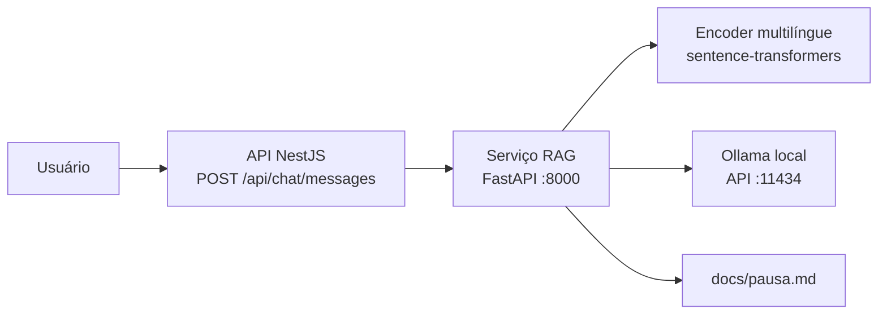

# Validação real do chatbot RAG com Ollama

> **Base atual:** o padrão agora é `docs/pausa.md`, escrito em linguagem simples para usuários e sem detalhes internos do sistema. As medições históricas abaixo foram feitas com a base técnica anterior (`CONTEXT.md` e `docs/requisitos.md`). Reinicie o serviço RAG após trocar a base para reconstruir o índice.

Este documento registra como executar o fluxo real do chatbot, o resultado observado em 2026-11-04 e os limites que ainda precisam ser acompanhados. O serviço Python é iniciado com Ollama local; a verificação completa inclui também a rota NestJS `POST /api/chat/messages`.

## Componentes do fluxo



- O NestJS valida a pergunta, limita-a a 500 caracteres e encaminha para `RAG_CHAT_URL` (padrão `http://127.0.0.1:8000/chat`). A resposta inclui `answer`, `topic: "rag"`, `sources` e `suggestions`.
- O FastAPI mantém um índice em memória criado ao iniciar. A rota `GET /health` informa `status` e `indexed_chunks`; `POST /chat` recebe `{"message":"..."}` e devolve `answer`, `sources` e `suggestions`.
- A base padrão atual é `backend/docs/pausa.md`. O corpus não consulta dados de agenda nem executa reservas ou cancelamentos.
- As linhas de tabelas Markdown viram trechos separados. A busca combina similaridade semântica (peso 0,55) e cobertura lexical (peso 0,45). A cobertura mínima para pedir resposta ao modelo é 0,5; os valores são constantes técnicas em `rag/main.py`.
- Se a melhor linha relacionada à pergunta contiver `[PREENCHER]`, `[VALIDAR]` ou `[DECIDIR]`, o serviço informa a pendência e não chama o modelo. Se nenhum trecho alcançar cobertura lexical suficiente, retorna a mensagem de informação não encontrada e não cita fontes irrelevantes.
- Para outros trechos, o modelo gera a resposta com temperatura 0,1 e limite de 600 tokens. A chamada do serviço Python e a chamada do NestJS têm limite de 60 segundos.

## Pré-requisitos

- Python 3.12, Ollama e Node.js instalados.
- Dependências Python de `rag/requirements.txt` instaladas em ambiente virtual.
- Modelo de chat disponível no Ollama e encoder configurado disponível no Hugging Face cache (o primeiro uso baixa os arquivos).
- PostgreSQL e API NestJS disponíveis para testar a rota completa. Para testar somente o serviço RAG, basta o Ollama e o FastAPI.
- Portas locais padrão livres: `11434` (Ollama), `8000` (FastAPI) e `3000` (NestJS).

## Execução local no Windows PowerShell

### 1. Preparar o Python e baixar modelos

Execute dentro de `backend/`:

```powershell
py -3.12 -m venv .venv-rag
.venv-rag\Scripts\Activate.ps1
python -m pip install -r rag\requirements.txt
ollama pull mistral
ollama pull qwen2.5:1.5b
```

O Mistral é o padrão do código. `qwen2.5:1.5b` foi usado apenas como modelo alternativo na validação desta máquina; ele não altera o padrão de produção. Se o servidor Ollama não estiver ativo, inicie o aplicativo Ollama ou execute `ollama serve` em outro terminal.

### 2. Iniciar o serviço RAG

Em outro terminal PowerShell, dentro de `backend/`:

```powershell
$env:OLLAMA_MODEL = "mistral"
python -m uvicorn main:app --app-dir rag --host 127.0.0.1 --port 8000
```

Para reproduzir o modelo alternativo da validação:

```powershell
$env:OLLAMA_MODEL = "qwen2.5:1.5b"
python -m uvicorn main:app --app-dir rag --host 127.0.0.1 --port 8000
```

Confira a indexação:

```powershell
Invoke-RestMethod http://127.0.0.1:8000/health
```

O campo `indexed_chunks` varia conforme o corpus e a versão do segmentador. Na validação registrada abaixo, eram 415 trechos dos dois documentos padrão.

### 3. Testar só o serviço RAG

```powershell
$body = @{ message = "Com quanta antecedência posso cancelar um atendimento?" } | ConvertTo-Json -Compress
$bytes = [System.Text.Encoding]::UTF8.GetBytes($body)
Invoke-RestMethod -Method Post -Uri http://127.0.0.1:8000/chat -ContentType "application/json; charset=utf-8" -Body $bytes
```

Enviar os bytes UTF-8 evita que o Windows PowerShell codifique o JSON como UTF-16 e o FastAPI rejeite o corpo.

### 4. Testar através do NestJS

Configure em `backend/.env`:

```dotenv
RAG_CHAT_URL=http://127.0.0.1:8000/chat
```

Inicie a API conforme as instruções do [AGENTS.md](../AGENTS.md) e envie a pergunta:

```powershell
$body = @{ message = "Com quanta antecedência posso cancelar um atendimento?" } | ConvertTo-Json -Compress
$bytes = [System.Text.Encoding]::UTF8.GetBytes($body)
Invoke-RestMethod -Method Post -Uri http://127.0.0.1:3000/api/chat/messages -ContentType "application/json; charset=utf-8" -Body $bytes
```

O endereço do FastAPI deve ser privado/local. A rota NestJS é pública e limitada pelo rate limit global; nunca exponha a porta `8000` diretamente.

## Testes automatizados sem Ollama

Em `backend/`, com as dependências instaladas:

```powershell
python -m unittest discover -s rag -p test_main.py
```

Os testes usam encoder e cliente de modelo simulados. Cobrem separação de linhas de tabela, ordenação semântica e lexical, regras pendentes, perguntas sem correspondência, estado de saúde, validação da entrada, fontes, sugestões, falhas do modelo e proteção contra prompt injection. Não baixam modelos e não substituem o teste real.

## Resultado registrado em 2026-11-04

### Ambiente utilizado

- Windows, Python 3.12.10 e Ollama 0.40.14.
- `sentence-transformers/paraphrase-multilingual-MiniLM-L12-v2` como encoder.
- `mistral` (4,4 GB) e `qwen2.5:1.5b` (986 MB) baixados pelo Ollama durante a validação.
- A API NestJS já estava disponível em `http://127.0.0.1:3000`; o serviço de teste foi iniciado em `http://127.0.0.1:8000`.
- Na validação histórica, o índice carregou 415 trechos da base técnica então configurada. A base padrão atual é o guia de linguagem simples `docs/pausa.md`.

### Falha encontrada antes da correção

- A pergunta “Com quanta antecedência posso cancelar um atendimento?” recebeu “24 horas” e, em outra chamada, uma regra de check-in. O requisito correto documenta 120 minutos como valor inicial **pendente de validação** (`[VALIDAR]`); portanto, o modelo não deveria apresentar um prazo confirmado.
- O trecho correto não aparecia entre os primeiros resultados porque tabelas inteiras eram agrupadas em blocos grandes. Linhas de outras regras de cancelamento/check-in competiam com a regra RN-01.
- Antes da correção, com `mistral`, a chamada direta ao Ollama respondeu, mas a resposta completa do RAG excedeu o timeout de 60 segundos e a API retornou `503` nesta máquina.
- A primeira tentativa com um encoder instalado sem acesso de rede falhou porque o modelo do Hugging Face ainda não estava no cache. O modelo foi baixado durante a validação e as tentativas seguintes usaram o cache local.

### Correção implementada e resultado após a correção

- O segmentador agora cria um trecho por linha de tabela; a busca combina similaridade semântica e cobertura lexical para recuperar a regra correta.
- Um valor marcado como pendente só gera resposta determinística quando a linha marcada é a correspondência lexical mais forte. Uma linha válida mais específica vence uma pendência não relacionada.
- Sem correspondência lexical mínima, o serviço retorna “Não encontrei essa informação nos documentos do sistema. Consulte o RH para confirmar.” e não chama o modelo.
- Com `qwen2.5:1.5b`, o RAG respondeu à pergunta de cancelamento: “Essa informação ainda está pendente de validação. Consulte o RH para confirmar. [requisitos.md]”. A mesma resposta foi confirmada pela API NestJS, com `topic: "rag"` e a fonte `requisitos.md`.
- Uma pergunta sobre o funcionamento das unidades retornou 8h–18h com fonte `requisitos.md`.
- Uma pergunta sobre a cor da parede, que não consta nos documentos, recebeu a mensagem de informação não encontrada e nenhuma fonte.
- Depois da correção, o Mistral padrão respondeu a pergunta de horário em **50,3 segundos** no primeiro pedido, com fonte `requisitos.md`. Uma repetição aquecida pela API NestJS respondeu em **9,5 segundos**, com `topic: "rag"` e a mesma fonte.
- `python -m unittest discover -s rag -p test_main.py`: **16 testes passaram**.

## Limitações e próximos passos

- A resposta fria do Mistral ficou a 9,7 segundos do timeout de 60 segundos. O teste confirmou sucesso, mas ainda convém repetir sob carga e em ambiente de deploy antes de considerar o limite operacional validado. Não aumentamos o timeout nem trocamos o modelo padrão.
- O teste Qwen confirma os caminhos de regra pendente, resposta documentada e fallback; ele não demonstra que qualquer modelo produzirá respostas corretas para toda pergunta suportada. Faça validação representativa antes de disponibilizar o serviço.
- A avaliação manual de acessibilidade do chat com NVDA + Chrome e a revisão de teclado, zoom, contraste, `forced-colors`, daltonismo e movimento reduzido continuam pendentes no TK-15.03/TK-15.04.
- As marcações `[PREENCHER]`, `[VALIDAR]` e `[DECIDIR]` nos requisitos continuam sendo pendências do grupo. O chatbot não deve tratá-las como decisões já aprovadas.

## Referências do repositório

- Implementação: [`rag/main.py`](../rag/main.py)
- Testes: [`rag/test_main.py`](../rag/test_main.py)
- Dependências: [`rag/requirements.txt`](../rag/requirements.txt)
- Execução local: [`chat-rag.md`](chat-rag.md)
- Requisitos oficiais: [`requisitos.md`](requisitos.md)
- Tickets: [TK-15.01](tickets/EP-15/TK-15.01-servico-rag.md), [TK-15.02](tickets/EP-15/TK-15.02-api-chat.md) e frontend [TK-15.03](../../frontend/docs/tickets/EP-15/TK-15.03-interface-chat.md), [TK-15.04](../../frontend/docs/tickets/EP-15/TK-15.04-validacao-chat.md)
