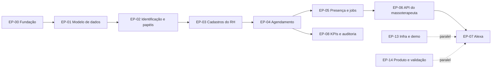

# Roadmap do sistema

Criado em 2026-10-19. Complementa o `docs/requisitos.md`, que define **o que** construir; este arquivo define **em que ordem**, **em que pedaços** e **com quem**. Se os dois divergirem, vale o `requisitos.md`.

## Como usar: spec → tickets → implement

O trabalho anda em três passos, sempre nesta ordem:

```
Épico (EP-NN)  ──spec──▶  docs/specs/EP-NN-<nome>.md  ──tickets──▶  TK-NN.MM  ──implement──▶  PR
```

| Passo | Entrada | Saída | Pronto quando |
| --- | --- | --- | --- |
| **Spec** | Um épico deste arquivo + `requisitos.md` + `CLAUDE.md` | `docs/specs/EP-NN-<nome>.md` | Contrato da API, modelo de dados afetado e critérios de aceite em Dado/Quando/Então para cada ticket; nenhuma decisão 🔒 em aberto no escopo |
| **Tickets** | A spec do épico | Um arquivo por linha da tabela do épico: `docs/tickets/EP-NN/TK-NN.MM-<slug>.md` (ver `docs/agents/issue-tracker.md`) | Cada ticket cabe em um PR e tem critérios de aceite, dependências e testes esperados |
| **Implement** | Um ticket | Branch `feat/TK-NN.MM-<slug>`, PR, status atualizado aqui | Definição de pronto do `CLAUDE.md` atendida |

Regras:

- **Um ticket 🔒 não vai para implement.** Primeiro resolva a decisão na tabela "Decisões pendentes" e registre no `requisitos.md`.
- **Um ticket por vez por pessoa**, respeitando a coluna "Depende de". Tickets sem dependência entre si podem rodar em paralelo.
- **Cada ticket tem um responsável** (coluna "Responsável"). Trocar de responsável é combinado entre os dois e registrado aqui no mesmo PR.
- **Tamanho:** P (até meio dia), M (cerca de um dia), G (dois a três dias; se passar disso, divida na spec).
- **Commits e testes citam os IDs de requisito** (RF/RN/RNF) e o ticket: `feat(appointments): TK-05.02 RF-02 book available slot`.
- **Ao terminar um ticket, atualize a coluna Status** deste arquivo no mesmo PR.

Legenda de status: ✅ feito · 🟡 existe código legado a refatorar · ⬜ a fazer · 🔒 bloqueado por decisão

### Prompts sugeridos

**Spec**

```
Leia CLAUDE.md, CONTEXT.md, docs/requisitos.md e o épico EP-NN em docs/roadmap.md.
Escreva docs/specs/EP-NN-<nome>.md com: objetivo, fora de escopo, contrato da API
(rotas, DTOs, respostas, erros e mensagens do catálogo), mudanças no modelo de dados,
critérios de aceite em Dado/Quando/Então para cada ticket do épico, casos de
acessibilidade (spokenText, ordem, fuso) e perguntas em aberto.
Não implemente nada. Se encontrar uma decisão 🔒 ou um [PREENCHER] no escopo, pare e pergunte.
```

**Tickets**

```
A partir de docs/specs/EP-NN-<nome>.md, crie um ticket para cada TK-NN.MM do épico com:
título, contexto (links para requisitos e spec), critérios de aceite copiados da spec,
arquivos prováveis, testes esperados, dependências e tamanho.
```

**Implement**

```
Implemente o TK-NN.MM seguindo CLAUDE.md e a spec do épico: TDD (teste falhando primeiro),
IDs de requisito nos nomes dos testes, branch feat/TK-NN.MM-<slug>.
Ao final rode npm run test, npm run lint e npm run build, e atualize o status no docs/roadmap.md.
```

## Visão geral

### Trilhas

| Trilha | Sigla | Onde |
| --- | --- | --- |
| Backend | BE | `backend/` (NestJS) |
| Alexa | ALX | skill customizada: modelo de interação versionado no repositório + endpoint no backend |
| Infraestrutura | INF | CI do backend, túnel da Alexa, hospedagem HTTPS e deploy do backend, dados de demonstração |
| Produto | PRD | validação com massoterapeutas e RH, valores das regras, roteiro da demo |

**Este roadmap cuida só do backend** (desde 2026-10-27). O frontend (épicos EP-09 a EP-12, CI e deploy do frontend: TK-13.01 e TK-13.06) tem roadmap próprio em `frontend/docs/roadmap.md`, com as próprias decisões (D-10, D-21 a D-28). Os IDs são globais no repositório (monorepo, D-17): nenhum épico, ticket ou decisão se repete entre os dois roadmaps.

### Marcos

Os marcos M2 a M5 são do projeto inteiro; aqui está a parte do backend. A parte do frontend de cada marco está em `frontend/docs/roadmap.md`.

| Marco | O que o backend entrega | Épicos do backend |
| --- | --- | --- |
| **M0 — Fundação** ✅ | Backend com lint, validação de ambiente, `Clock` e parâmetros de negócio centralizados | EP-00 (parcial) |
| **M1 — Domínio** ✅ | Modelo de dados final, máquina de estados testada, papéis e identificação | EP-01, EP-02 (concluídos em 2026-10-19 e 2026-10-20) |
| **M2 — Colaborador agenda sozinho** | API de horários, reserva, cancelamento, lista de espera e check-in | EP-03, EP-04, EP-05 |
| **M3 — Massoterapeuta autônomo** | API do massoterapeuta com `spokenText` e skill da Alexa, para ele passar o dia sem pedir informação a ninguém (métrica principal) | EP-06, EP-07 |
| **M4 — RH no controle** | API de cadastros, agendas, parâmetros, KPIs e auditoria | EP-03, EP-08 |
| **M5 — Demonstração** | Backend publicado com HTTPS, dados de demo, roteiro ensaiado e validado com os massoterapeutas | EP-13, EP-14 |

### Dependências entre épicos



O frontend consome os épicos EP-02 a EP-08; as dependências dele estão em `frontend/docs/roadmap.md` ("O que o frontend precisa do backend").

**Comece cedo, em paralelo:**
- **TK-07.01**, o spike da skill da Alexa, e **TK-07.09**, o spike da Reminders API (Guilherme): são os maiores riscos técnicos do projeto.
- **EP-14**, a validação com os massoterapeutas: as respostas mudam as frases da Alexa, os `spokenText` da API e a interface.

## Divisão do trabalho

Duas pessoas, divididas por área do domínio, não por camada. Cada uma leva a sua área do backend até a tela; a divisão das telas está no roadmap do frontend.

| Pessoa | Área no backend | Épicos que lidera (escreve a spec e revisa os tickets) |
| --- | --- | --- |
| **Mariana** | Núcleo do domínio e jornada do colaborador e do RH: modelo de dados, agenda, reserva, lista de espera, presença, KPIs | EP-01, EP-03, EP-04, EP-05, EP-08 |
| **Guilherme** | Tudo o que o massoterapeuta toca: Alexa, API do massoterapeuta, avisos, identificação e infraestrutura | EP-00, EP-02, EP-06, EP-07, EP-13, EP-14 |

Quem lidera o épico escreve a spec; os tickets podem ter o outro como responsável (a coluna "Responsável" de cada tabela vale). Carga do backend, sem o frontend: cerca de 27 dias para a Mariana e 28 para o Guilherme, que concentra os tickets G da Alexa (TK-07.07, TK-07.10), os de maior risco.

### Por que assim

- **A cadeia do EP-01 é sequencial** (TK-01.01 → 01.02 → 01.03 → 01.04) e mexe no `schema.prisma` inteiro. Fica com uma pessoa só (Mariana).
- **Na primeira semana o Guilherme não encosta no código existente:** CI, spikes da Alexa e o formatador de fala (TK-06.01, sem dependência) são arquivos novos ou externos. Os renomes do TK-01.01 e TK-01.02 entram sem conflito.
- **O massoterapeuta é o usuário principal.** A mesma pessoa cuida da Alexa, da API que a alimenta (EP-06) e dos avisos (TK-05.01), e também da tela dele no frontend. Uma pessoa só decide como ele ouve e lê a informação.

### Ordem sugerida

**Mariana**

1. TK-01.01 → TK-01.02 → TK-01.03 → TK-01.04 (fazer merge rápido, em PRs pequenos: tudo depende disso)
2. TK-03.03 → TK-04.01 → TK-04.02 (desbloqueia o TK-06.02 do Guilherme)
3. TK-01.06 → TK-01.07 (o seed espera o TK-01.05 do Guilherme)
4. TK-04.03 → TK-04.04 → TK-04.08 → TK-04.05 → TK-03.04
5. TK-05.02 (espera o TK-05.01 do Guilherme) → TK-05.03 → TK-05.04
6. TK-03.02 → TK-03.07 → TK-08.03
7. Pedidos do frontend: TK-04.10 → TK-03.10 → TK-04.09 (desbloqueiam o TK-10.02 e o TK-10.04)

**Guilherme**

1. ~~TK-00.07 → TK-00.05 (CI)~~ ✅ 2026-10-21
2. TK-07.01 → TK-07.09 (spikes) → TK-06.01 (formatador) → TK-07.04 → TK-13.02
3. ~~TK-02.01 → TK-02.02 (depois do TK-01.01 da Mariana)~~ ✅ 2026-10-20, com o TK-02.03
4. TK-01.05 (depois do TK-01.02 da Mariana) → TK-07.02 → TK-07.03 → TK-03.08 → TK-07.05 → TK-07.08
5. TK-05.01 (depois do TK-01.04 da Mariana) → TK-03.01
6. TK-06.02 (depois do TK-04.02 da Mariana) → TK-07.06 → TK-06.03 → TK-06.06, TK-06.05 e TK-06.07 (depois do TK-03.06)
7. TK-07.09 (spike do lembrete) o quanto antes, num Echo real; depois TK-13.03 e TK-13.04 (D-09 decidida em 2026-10-23)

### Regras de convivência

- **Schema e migrações.** A Mariana é dona do `schema.prisma` durante o EP-01. O Guilherme só cria migração (TK-01.05) depois que o TK-01.02 entrar na `main`, já com `@@map`/`@map` em `snake_case`. Se duas migrações ficarem abertas ao mesmo tempo, quem fizer merge por último apaga a própria pasta de migração, faz rebase e roda `npm run prisma:migrate` de novo.
- **Rebase logo após os renomes.** Quando o TK-01.01 ou o TK-01.02 entrar, o outro faz rebase no mesmo dia.
- **Arquivos compartilhados** (`notifications/messages.ts`, `app.module.ts`, este roadmap): cada um acrescenta no fim ou na sua seção; conflito aqui se resolve no rebase, sem conversa.
- **Contratos entre as trilhas** são combinados na spec, antes do código: nome e payload dos eventos (`appointment.booked`, `appointment.cancelled`, `employee.checked-in`), interface do `NotificationChannel` e o que o `AppointmentsService` exporta. A spec do EP-04 e do EP-05 (Mariana) é revisada pelo Guilherme; a do EP-06 e do EP-07 (Guilherme), pela Mariana.
- **Contrato com o frontend.** Mudança em rota, DTO ou mensagem usada pelo frontend avisa no PR e atualiza junto o esquema Zod do frontend (`frontend/src/shared/api/schemas.ts`), no mesmo PR quando possível. Pedido de rota nova vindo do frontend entra como ticket neste roadmap.
- **Revisão cruzada.** Todo PR é revisado pela outra pessoa. Prioridade de revisão: TK-01.04 (máquina de estados, usada no TK-06.03) e TK-06.01 (formatador, usado nas mensagens de todo o sistema).
- **Decisões pendentes** têm quem cobra (coluna "Quem cobra"). A D-04 e a D-05 travam as duas trilhas: feche primeiro.

## Decisões pendentes

Cada linha bloqueia os tickets indicados. Ao decidir, registre no `requisitos.md` (tabela "Decisões registradas") e troque 🔒 por ⬜ aqui.

| ID | Decisão | Bloqueia | Sugestão | Quem cobra |
| --- | --- | --- | --- | --- |
| D-01 | Valores das regras RN-01 a RN-11 | Nada para codar (são parâmetros); precisa estar validado antes da demo | Validar com o RH na EP-14 | Mariana |
| ~~D-02~~ | ~~Como facilitar a montagem da agenda diária (RF-26)~~ Decidido em 2026-10-20: copiar agenda de um dia modelo para um conjunto de datas futuras (`POST /schedules/copy`) com registros concretos (spec do EP-03) | TK-03.05 | — | Mariana |
| ~~D-03~~ | ~~Reagendamento (RF-08) entra no MVP?~~ Decidido em 2026-10-20: fora do MVP; cancelar a sessão e reservar novamente | TK-04.07 | — | Mariana |
| ~~D-04~~ | ~~Bloqueio sobre um período com atendimentos já marcados: recusa, ou cancela e avisa?~~ Decidido em 2026-10-20: recusar com 409 e listar os atendimentos conflitantes (ação consciente, spec do EP-03) | TK-03.06, TK-06.07, TK-07.07 | — | Guilherme |
| ~~D-05~~ | ~~A antecedência mínima de cancelamento (RN-01) vale para o massoterapeuta?~~ Decidido em 2026-10-22: não vale; ele cancela a qualquer momento e o colaborador é avisado | TK-06.06 | — | Guilherme |
| ~~D-06~~ | ~~Sessão em `chegou` que o massoterapeuta nunca iniciou: o que acontece no horário de término?~~ Decidido em 2026-10-20: concluir automaticamente como `COMPLETED`, seguindo a RN-16 | TK-05.05 | — | Mariana |
| ~~D-07~~ | ~~Como a tela do massoterapeuta recebe avisos em tempo real (RF-31): consulta periódica ou SSE~~ Decidido em 2026-10-26: consulta periódica no protótipo; `GET /notifications` com `since`, `spokenText` e marcação como lido (TK-06.04) | TK-06.04 | — | Guilherme |
| ~~D-08~~ | ~~Quais KPIs o RH quer (RF-21)~~ Decidido em 2026-10-21: turnos manhã/tarde, volume nos sete dias da semana, horários de início mais procurados e taxa/número absoluto de cancelamentos agrupados pela data do atendimento; remarcação fica fora do MVP até haver vínculo explícito | TK-08.01 | `docs/requisitos.md`, seção KPIs do RF-21 | Mariana |
| ~~D-09~~ | ~~Hospedagem com HTTPS público (obrigatória para a Alexa fora do túnel de desenvolvimento)~~ Decidido em 2026-10-23: backend e PostgreSQL em contêiner sempre ligado com o `Dockerfile` (Render, Railway ou Fly.io, escolhido no TK-13.03). Backend na Vercel descartado: jobs de minuto em minuto e o limite de 8 s da Alexa. O frontend vai para a Vercel (roadmap do frontend) | TK-13.03, TK-13.04 | — | Guilherme |
| ~~D-12~~ | ~~Como o frontend escolhe o usuário no protótipo, sem login~~ Decidido em 2026-10-20: tela "Entrar como…" alimentada por `GET /auth/demo-users`, só com `AUTH_MODE=header` (spec do EP-02) | TK-02.03 | — | Guilherme |
| ~~D-13~~ | ~~Como o colaborador fica sabendo de uma vaga sem e-mail~~ Decidido em 2026-11-03: notificacao interna associada a entrada da fila; texto inclui unidade e terapeuta, com acoes aceitar/recusar em Suas sessoes. | TK-04.06, TK-04.09 | — | Mariana |
| D-14 | Prioridades em branco ([M/S/C/W]): RF-04, RF-06, RF-09, RF-12 a RF-16, RF-22, RF-23, RF-26, RF-27, RF-31, RF-33 | Ordem e corte de escopo | Definir antes de M2 | Mariana |
| ~~D-15~~ | ~~A Reminders API funciona com lembrete criado pelo backend? (RF-16)~~ Decidido em 2026-10-22: não; a API só cria lembrete durante uma conversa. A Alexa cria os lembretes do dia quando o massoterapeuta conversa com ela, e o cancelamento apaga fora da conversa (spec do EP-07; o TK-07.09 confirma no aparelho) | TK-07.10 | — | Guilherme |
| ~~D-16~~ | ~~O lembrete falado diz o nome do colaborador?~~ Decidido em 2026-10-22: sem nome (privacidade) | TK-07.10 | — | Guilherme |
| ~~D-18~~ | ~~Formato (quantos dígitos) e validade do código de pareamento da Alexa; validade como parâmetro editável pelo RH ou constante técnica (vinda do EP-01, spec do EP-03)~~ Decidido em 2026-10-22: 6 dígitos numéricos, 60 minutos, constante técnica; um código ativo por massoterapeuta | TK-03.08 | — | Guilherme |
| D-20 | Há limite de massoterapeutas atendendo ao mesmo tempo na mesma sala (capacidade da sala)? | TK-03.09 | Sem limite no MVP: o RH monta a agenda | Mariana |
| ~~D-19~~ | ~~Uma Alexa serve a vários massoterapeutas (RN-17). Como ela sabe quem está falando?~~ Decidido em 2026-10-22: o aparelho guarda vários massoterapeutas vinculados; a Alexa deduz quem fala (um único vinculado, ou só um com `ScheduleSlot` naquele momento) e, se não der, pergunta o nome, válido até o fim da conversa. Pede migração em `AlexaDevice` (spec do EP-07) | TK-07.05, TK-07.03 | — | Guilherme |

Decisões do frontend (D-10, D-17 e D-21 a D-28) ficam em `frontend/docs/roadmap.md`; as já decididas estão registradas no `docs/requisitos.md`.

## Épicos e tickets

### EP-00 — Fundação do backend (BE, INF)

**Lidera:** Guilherme

| Ticket | Descrição | Requisitos | Depende de | Tam. | Responsável | Status |
| --- | --- | --- | --- | --- | --- | --- |
| TK-00.01 | ESLint + Prettier, scripts `lint`, `format`, `format:check` | — | — | P | — | ✅ |
| TK-00.02 | Validação das variáveis de ambiente na inicialização | — | — | P | — | ✅ |
| TK-00.03 | `Clock`, `SystemClock`, `FakeClock`; remover `new Date()` das regras | RNF-05 | — | P | — | ✅ (falta Alexa, ver TK-07.03) |
| TK-00.04 | `BusinessRulesService` e parâmetros de negócio no ambiente | RN-01 a RN-11 | — | M | — | ✅ |
| TK-00.05 | CI no GitHub Actions: `lint`, `format:check`, `test`, `build` e `test:e2e` a cada PR | — | — | P | Guilherme | ✅ |
| TK-00.06 | Testes e2e com Supertest em `test/` e banco PostgreSQL de teste em container | — | — | M | — | ✅ |
| TK-00.07 | Tirar `tsconfig.build.tsbuildinfo` do git e ignorar `*.tsbuildinfo` | — | — | P | Guilherme | ✅ |

### EP-01 — Modelo de dados e máquina de estados (BE)

**Lidera:** Mariana

**A spec deve cobrir:**
- a migração dos dados existentes (o banco não está em produção, mas o seed de demo precisa continuar funcionando);
- a tabela de transições completa do `requisitos.md`, incluindo a RN-16 e o início sem check-in;
- quem pode disparar cada transição (colaborador, massoterapeuta, RH, sistema).

| Ticket | Descrição | Requisitos | Depende de | Tam. | Responsável | Status |
| --- | --- | --- | --- | --- | --- | --- |
| TK-01.01 | Papéis `EMPLOYEE`, `THERAPIST`, `HR`, `ADMIN` no schema (substitui `COLLABORATOR` e o uso de `ADMIN` como RH) | Decisão 2026-10-19 | — | M | Mariana | ✅ |
| TK-01.02 | Renomes do glossário: `collaboratorId` → `employeeId`, `AvailabilityWindow` → `ScheduleSlot`; tabelas e colunas em `snake_case` via `@@map`/`@map` | — | TK-01.01 | M | Mariana | ✅ |
| TK-01.03 | Novo `AppointmentStatus` (`BOOKED`, `CONFIRMED`, `CHECKED_IN`, `POSSIBLE_NO_SHOW`, `IN_PROGRESS`, `COMPLETED`, `CANCELLED`, `RELEASED`, `NO_SHOW`); ajustar as restrições de sobreposição | RN-12 | TK-01.02 | M | Mariana | ✅ |
| TK-01.04 | `appointment-status.ts`: tabela de transições pura, `InvalidStatusTransitionException`, testes de todas as transições válidas e inválidas | Máquina de estados, RN-16 | TK-01.03 | M | Mariana | ✅ |
| TK-01.05 | Tabelas `AlexaDevice` e código de pareamento (validade, uso único) | RF-17 | TK-01.02 | P | Guilherme | ✅ |
| TK-01.06 | Tabela de parâmetros de negócio; `BusinessRulesService` lê do banco, usando o ambiente como valor inicial | RF-27 | TK-01.01 | M | Mariana | ✅ |
| TK-01.07 | Seed de demonstração: 2 unidades, salas, 2 ou mais massoterapeutas, colaboradores, RH, ADMIN e agendas das próximas semanas | — | TK-01.01 a TK-01.06 | M | Mariana | ✅ |

### EP-02 — Identificação e papéis (BE)

**Lidera:** Guilherme

**A spec deve cobrir:** a matriz de permissões por rota (o `ADMIN` herda tudo do `HR`) e o formato de `GET /me`, que o frontend usa para decidir quais telas mostrar.

| Ticket | Descrição | Requisitos | Depende de | Tam. | Responsável | Status |
| --- | --- | --- | --- | --- | --- | --- |
| TK-02.01 | Módulo `auth/`: guard de identificação (`x-user-id`) e `RolesGuard` com herança `ADMIN` ⊃ `HR` | Decisão 2026-10-16 | TK-01.01 | M | Guilherme | ✅ |
| TK-02.02 | `GET /me`: perfil, papel e primeiro nome | — | TK-02.01 | P | Guilherme | ✅ |
| TK-02.03 | Lista de usuários de demonstração para o seletor do protótipo (só com `AUTH_MODE=header`) | D-12 | TK-02.01 | P | Guilherme | ✅ |

### EP-03 — Cadastros do RH (BE)

**Lidera:** Mariana (spec). Os tickets restantes (TK-03.05, TK-03.06, TK-03.09) passaram para o Guilherme em 2026-10-23.

**Spec:** `docs/specs/EP-03-cadastros-do-rh.md` (Mariana, 2026-10-20). Tickets em `docs/tickets/EP-03/`. Os tickets TK-03.01, 03.02, 03.04, 03.07 e 03.08 foram alinhados à spec em 2026-10-21 e trazem, em "Comentários", as propostas que ainda não estão nela (a confirmar com a Mariana).

**A spec deve cobrir:**
- validações: a agenda respeita a RN-08 e não pode ter períodos sobrepostos para o mesmo massoterapeuta (a mesma sala pode, desde 2026-10-23: TK-03.09);
- auditoria de toda alteração;
- regeneração do QR Code da sala, que invalida o código antigo.

| Ticket | Descrição | Requisitos | Depende de | Tam. | Responsável | Status |
| --- | --- | --- | --- | --- | --- | --- |
| TK-03.01 | Módulo `users/`: listar, criar, ativar e desativar usuários (com o perfil de massoterapeuta) | RF-20 | TK-02.01 | M | Guilherme | ✅ |
| TK-03.02 | Módulo `rooms/`: listar e criar salas; token de check-in regenerável | RF-24 | TK-02.01 | M | Mariana | ✅ |
| TK-03.03 | Módulo `schedules/`: criar, listar, editar e remover períodos da agenda diária (data, horário, sala) | RF-25, RN-05, RN-08 | TK-01.02 | M | Mariana | ✅ |
| TK-03.04 | Remover ou alterar um período da agenda que já tem atendimentos marcados: recusar e informar quais | RF-25 | TK-03.03 | P | Mariana | ✅ |
| TK-03.05 | Facilitar a montagem da agenda (por exemplo, copiar um dia para um intervalo de datas) | RF-26 | TK-03.03 | M | Guilherme | ✅ |
| TK-03.06 | Bloqueios de horário pelo RH; cria o service de regras de bloqueio do `schedule-blocks/`, reaproveitado pelo TK-06.07 | RF-23 | TK-03.03 | P | Guilherme | ✅ |
| TK-03.07 | Editar os parâmetros de negócio, com validação de consistência e auditoria | RF-27 | TK-01.06 | M | Mariana | ✅ |
| TK-03.08 | Gerar código de pareamento da Alexa para um massoterapeuta | RF-17 | TK-01.05 | P | Guilherme | ✅ |
| TK-03.09 | RN-12 revisada (2026-10-23): permitir vários massoterapeutas ao mesmo tempo na mesma sala; tirar a restrição de sobreposição por sala dos atendimentos (`appointments_room_no_overlap`) e dos períodos da agenda, mantendo a do massoterapeuta | RN-12 | TK-03.03, TK-01.03 | P | Guilherme | 🔒 D-20 |
| TK-03.10 | **Pedido do frontend (2026-10-27):** rota de unidades para o colaborador (código, nome e fuso das unidades ativas), para o filtro de unidade não depender dos horários devolvidos | RF-01 | TK-03.02 | P | Mariana | ✅ |

### EP-04 — Agendamento do colaborador (BE)

**Lidera:** Mariana

**A spec deve cobrir:**
- o contrato dos horários disponíveis (filtros por unidade e por massoterapeuta, ordem cronológica);
- erros com mensagens do catálogo;
- o teste de concorrência com banco real (duas reservas simultâneas no mesmo horário: só uma vence);
- os eventos `appointment.booked` e `appointment.cancelled`.

| Ticket | Descrição | Requisitos | Depende de | Tam. | Responsável | Status |
| --- | --- | --- | --- | --- | --- | --- |
| TK-04.01 | Módulo `appointments/` e `schedules/`: horários disponíveis, a partir do código atual de `booking/` | RF-01, RN-05, RN-07, RN-08, RN-12 | TK-03.03 | M | Mariana | ✅ |
| TK-04.02 | Reservar: nasce `CONFIRMED`, limite de reservas (RN-06), concorrência com retry de deadlock | RF-02, RN-01, RN-06, RN-12 | TK-04.01, TK-01.04, TK-00.06 | M | Mariana | ✅ |
| TK-04.03 | Cancelar pelo colaborador e emitir `appointment.cancelled` | RF-03, RN-01 | TK-04.02 | P | Mariana | ✅ |
| TK-04.04 | Meus agendamentos (próximos e anteriores) | RF-07 | TK-04.02 | P | Mariana | ✅ |
| TK-04.05 | Próxima sessão para o card de lembrete da página inicial | RF-09 | TK-04.04 | P | Mariana | ✅ |
| TK-04.06 | Lista de espera: entrar em periodos ocupados por agendamento com terapeuta/unidade, sair, aceitar, recusar oferta e avancar fila; expirar e oferecer ao proximo | RF-04, RN-10 | TK-04.03 | G | Mariana | ✅ |
| TK-04.07 | Reagendar sessão | RF-08 | TK-04.03 | M | Mariana | ✅ |
| TK-04.08 | Listener de auditoria para todos os eventos de agendamento | — | TK-04.03 | P | Mariana | ✅ |
| TK-04.09 | **Pedido do frontend:** listar entradas proprias com status, prazo e `spokenText`, incluindo terapeuta/unidade e IDs; aviso `WAITLIST_VACANCY` permite aceitar/recusar a entrada | RF-04, RN-10 | TK-04.06 | P | Mariana | ✅ |
| TK-04.10 | **Pedido do frontend (2026-10-27):** expor ao colaborador a duração vigente da sessão (por exemplo, na resposta de `GET /booking/availability`), para a tela parar de descobrir a duração por tentativa | RF-01, RN-05 | TK-04.01, TK-03.07 | P | Mariana | ✅ |
| TK-04.11 | Avisar que não vai: o colaborador cancela até o início, mesmo dentro da antecedência mínima (cancelamento tardio, não conta como ausência); avisa o massoterapeuta (MSG-08) e oferece a vaga à fila com prazo até o início | RF-03, RN-01, RF-04, RN-10 | TK-04.03, TK-04.06 | M | [PREENCHER] | ⬜ |

### EP-05 — Presença e jobs (BE)

**Lidera:** Mariana

**A spec deve cobrir:**
- jobs idempotentes, testados rodando duas vezes;
- avisos ao massoterapeuta pelo `NotificationChannel`;
- o `InMemoryNotificationChannel` para os testes.

| Ticket | Descrição | Requisitos | Depende de | Tam. | Responsável | Status |
| --- | --- | --- | --- | --- | --- | --- |
| TK-05.01 | `NotificationChannel` (interface e token), `InMemoryNotificationChannel` e avisos guardados no banco para consulta na tela | RF-31, RNF-01 | TK-01.04 | M | Guilherme | ✅ |
| TK-05.02 | Check-in por QR Code: `CONFIRMED` → `CHECKED_IN`, dentro da janela (RN-09, RN-02); avisa o massoterapeuta | RF-06, RN-02, RN-09 | TK-04.02, TK-05.01 | M | Mariana | ✅ |
| TK-05.03 | Job de tolerância: `CONFIRMED` sem check-in após a RN-02 → `POSSIBLE_NO_SHOW`; avisa o massoterapeuta | RN-02 | TK-05.01 | M | Mariana | ✅ |
| TK-05.04 | Job de conclusão automática: `IN_PROGRESS` → `COMPLETED` no horário de término | RN-16 | TK-01.04 | P | Mariana | ✅ |
| TK-05.05 | Sessão em `CHECKED_IN` nunca iniciada | Máquina de estados, D-06 | TK-05.04 | P | Mariana | ✅ |

### EP-06 — API do massoterapeuta (BE)

**Lidera:** Guilherme

**Spec:** `docs/specs/EP-06-api-do-massoterapeuta.md` (Guilherme, 2026-10-23), com as decisões da sessão de perguntas do mesmo dia.

**Pendência:** migrar os eventos de `Appointment` da classe `AppointmentEvents` para o `@nestjs/event-emitter`, como prevê o `AGENTS.md`. Fica para quando surgir um terceiro tipo de listener; o EP-06 continua na `AppointmentEvents`.

**A spec deve cobrir:**
- `spokenText` em toda resposta;
- horários "às 14h" no fuso `America/Sao_Paulo`;
- só o primeiro nome do colaborador;
- listas em ordem cronológica;
- confirmação explícita antes de ações que alteram dados.

Os mesmos services atendem a tela e a Alexa.

| Ticket | Descrição | Requisitos | Depende de | Tam. | Responsável | Status |
| --- | --- | --- | --- | --- | --- | --- |
| TK-06.01 | Formatador de fala pt-BR, usado pela tela e pela Alexa: horários por extenso, primeiro nome, frases curtas. Testes de formato, tamanho e ordem | RNF-01, RNF-04, RNF-05 | — | M | Guilherme | ✅ |
| TK-06.02 | Agenda: atendimento atual, próximo e dia inteiro, com `spokenText` e "hoje" calculado em `America/Sao_Paulo` | RF-30, RF-10, RF-11, RF-15, RN-14 | TK-06.01, TK-04.02 | M | Guilherme | ✅ |
| TK-06.03 | Ações: iniciar (inclusive sem check-in e sem ID) e finalizar sessão, com o texto do resultado; cria o `TherapistActionsService` | RF-32, RF-14, RN-12, RN-13 | TK-06.02 | M | Guilherme | ✅ |
| TK-06.04 | Feed de avisos para a tela (`aria-live`) | RF-31 | TK-05.01 | P | Guilherme | ✅ |
| TK-06.05 | Marcar ausência: `POSSIBLE_NO_SHOW` → `NO_SHOW` | RF-33 | TK-05.03, TK-06.03 | P | Guilherme | ✅ |
| TK-06.06 | Cancelar pelo massoterapeuta a qualquer momento (D-05): aviso ao colaborador (MSG-07), sem oferta à lista de espera, evento de cancelamento corrigido | RF-12, RF-32, RN-13 | TK-06.03 | M | Guilherme | ✅ |
| TK-06.07 | Bloquear horário pelo massoterapeuta, com prévia e as regras do TK-03.06 (D-04) | RF-13, RF-32, RN-08 | TK-06.03, TK-03.06 | P | Guilherme | ✅ |

### EP-07 — Alexa (ALX, BE)

**Lidera:** Guilherme

**A spec deve cobrir:**
- o modelo de interação pt-BR (intents, slots `AMAZON.TIME`, frases de exemplo validadas com os massoterapeutas);
- a confirmação por voz (diálogo da Alexa) antes de cada ação;
- respostas de uma ou duas frases;
- o comportamento de um aparelho não pareado.

| Ticket | Descrição | Requisitos | Depende de | Tam. | Responsável | Status |
| --- | --- | --- | --- | --- | --- | --- |
| TK-07.01 | **Spike:** conta de desenvolvedor, skill em pt-BR, endpoint local via túnel HTTPS, "olá" de ponta a ponta num Echo real | — | — | M | Guilherme | ✅ |
| TK-07.02 | `AlexaSignatureGuard`: assinatura, certificado e horário da requisição | RNF-03 | TK-07.01 | M | Guilherme | ✅ |
| TK-07.03 | Arquitetura de handlers (`AlexaIntentHandler` com `canHandle`/`handle`); migrar os intents atuais e tirar `new Date()` (o `ALEXA_USER_MAP` fica até o TK-07.05) | — | TK-07.02 | M | Guilherme | 🟡 |
| TK-07.04 | Modelo de interação versionado no repositório e publicação pela ASK CLI; mesmo PR do TK-07.03 | — | TK-07.01, TK-07.03 | P | Guilherme | ⬜ |
| TK-07.05 | Intent de pareamento: "vincular código {código}", vários massoterapeutas por aparelho e identificação de quem fala (D-19); remove o `ALEXA_USER_MAP` | RF-17, RN-17 | TK-03.08, TK-07.03 | M | Guilherme | ✅ |
| TK-07.06 | Consultas: próximo, agenda do dia, quem chegou | RF-10, RF-11, RF-15, RN-14 | TK-06.02, TK-07.05 | M | Guilherme | 🟡 |
| TK-07.07 | Ações por voz: cancelar e bloquear (por horário falado, com confirmação), iniciar e finalizar sessão (sem confirmação) | RF-12, RF-13, RF-14 | TK-06.03, TK-06.06, TK-06.07, TK-07.05 | G | Guilherme | ⬜ |
| TK-07.08 | Ajuda, parar, fallback e "repetir" | RNF-02 | TK-07.03 | P | Guilherme | 🟡 |
| TK-07.09 | **Spike:** num Echo real, criar lembrete durante a conversa, apagá-lo fora dela e testar a atualização fora dela (D-15) | RF-16 | TK-07.01 | M | Guilherme | ⬜ (o quanto antes) |
| TK-07.10 | Lembrete falado antes de cada sessão: criado durante a conversa com a Alexa, apagado se a sessão for cancelada | RF-16, RN-15 | TK-07.09, TK-07.05, TK-05.01 | G | Guilherme | ⬜ |

### EP-08 — KPIs e auditoria (BE)

**Lidera:** Mariana

| Ticket | Descrição | Requisitos | Depende de | Tam. | Responsável | Status |
| --- | --- | --- | --- | --- | --- | --- |
| TK-08.01 | Definir os KPIs e as fórmulas com o RH | RF-21 | — | P | Mariana | ✅ |
| TK-08.02 | Módulo `reports/`: endpoints dos KPIs por período, unidade e massoterapeuta | RF-21 | TK-08.01, TK-04.02 | G | Mariana | ✅ |
| TK-08.03 | Consulta da auditoria com filtros e paginação | RF-22 | TK-04.08 | M | Mariana | ✅ |

### EP-09 a EP-12 — Frontend

Não ficam neste roadmap. Base do frontend (EP-09), telas do colaborador (EP-10), do massoterapeuta (EP-11) e do RH (EP-12) estão em `frontend/docs/roadmap.md`. Os pedidos do frontend ao backend entram como tickets nos épicos deste arquivo (TK-03.10, TK-04.09, TK-04.10).

### EP-13 — Infraestrutura e demonstração (INF)

**Lidera:** Guilherme. A CI e o deploy do frontend (TK-13.01 e TK-13.06) estão em `frontend/docs/roadmap.md`.

| Ticket | Descrição | Requisitos | Depende de | Tam. | Responsável | Status |
| --- | --- | --- | --- | --- | --- | --- |
| TK-13.02 | Túnel HTTPS para desenvolvimento da Alexa, documentado no `CLAUDE.md` | — | TK-07.01 | P | Guilherme | ⬜ |
| TK-13.03 | Hospedagem com HTTPS público do backend e do PostgreSQL em contêiner sempre ligado (escolher Render, Railway ou Fly.io), com CORS liberando só a origem do frontend publicado | — | — | M | Guilherme | ⬜ |
| TK-13.04 | Deploy automático do backend a cada merge, com as migrações aplicadas | — | TK-13.03, TK-00.05 | M | Guilherme | ⬜ |
| TK-13.05 | Script de dados de demonstração e roteiro da demo, com plano B se a Alexa falhar ao vivo | — | TK-01.07 | P | Mariana | ⬜ |

### EP-14 — Produto e validação (PRD)

**Lidera:** Guilherme

| Ticket | Descrição | Requisitos | Depende de | Tam. | Responsável | Status |
| --- | --- | --- | --- | --- | --- | --- |
| TK-14.01 | Preencher o perfil do massoterapeuta com as entrevistas (tabela do `requisitos.md`) | — | — | P | Guilherme | ⬜ |
| TK-14.02 | Validar os valores das regras RN-01 a RN-11 com o RH | D-01 | — | P | Mariana | ⬜ |
| TK-14.03 | Validar as frases da Alexa e os `spokenText` da API com os massoterapeutas | RNF-02 | TK-07.01 | M | Guilherme | ⬜ |
| TK-14.04 | Definir prioridades MoSCoW em branco | D-14 | — | P | Mariana | ⬜ |
| TK-14.05 | Teste de usabilidade: um dia simulado sem pedir informação a ninguém (métrica principal), com a Alexa e a tela do massoterapeuta | Métricas de sucesso | M3 (inclui o TK-11.04 do frontend) | M | Guilherme | ⬜ |

### EP-16 — Pesquisa de satisfação (BE)

**Lidera:** Mariana · **Spec:** `docs/specs/EP-16-pesquisa-de-satisfacao.md`

| Ticket | Descrição | Requisitos | Depende de | Tam. | Responsável | Status |
| --- | --- | --- | --- | --- | --- | --- |
| TK-16.01 | Persistir respostas anônimas e validar envio, sem vínculo a colaborador/sessão nem deduplicação | RF-34, RN-18 | — | M | Mariana | ✅ |
| TK-16.02 | Relatório para RH com distribuições, médias e comentários sem metadados de identidade/sessão | RF-34, RN-18 | TK-16.01 | M | Mariana | ✅ |
## Tickets de backend do EP-15 — Assistente informativo com RAG

A definição do épico e os tickets de frontend estão em [EP-15 no roadmap do frontend](../../frontend/docs/roadmap.md#ep-15--assistente-informativo-com-rag-be--fe). A prioridade do RF-34 permanece em aberto.

| Ticket | Descrição | Requisitos | Depende de | Tam. | Responsável | Status |
| --- | --- | --- | --- | --- | --- | --- |
| TK-15.01 | Serviço Python RAG: indexar documentos oficiais, recuperar trechos, responder sem inventar informações e expor saúde do índice | RF-34, RNF-04 | — | G | Guilherme | ✅ |
| TK-15.02 | API NestJS `POST /api/chat/messages`: validar pergunta, encaminhar ao serviço RAG, devolver resposta/fontes/sugestões e tratar indisponibilidade | RF-34, RNF-04 | TK-15.01 | M | Guilherme | ✅ |

## Fora do MVP (não iniciar sem pedido explícito)

| Item | Requisitos | Observação |
| --- | --- | --- |
| Login com Google (Workspace) | — | Só se der tempo. O backend já tem um modo `AUTH_MODE=google` parcial |
| Lembrete por e-mail com confirmação de presença | RF-05, RN-03, RN-11 | Ativa a reserva `BOOKED` e a liberação automática de quem não confirma |
| Web Push (lado do backend) | — | Inscrições por aparelho e envio dos avisos ao massoterapeuta com a tela fechada; a parte da tela está no roadmap do frontend |
| Google Calendar | — | Sem dado de saúde no evento |
| Campainha virtual da Alexa | — | Anúncio de chegada em tempo real |
