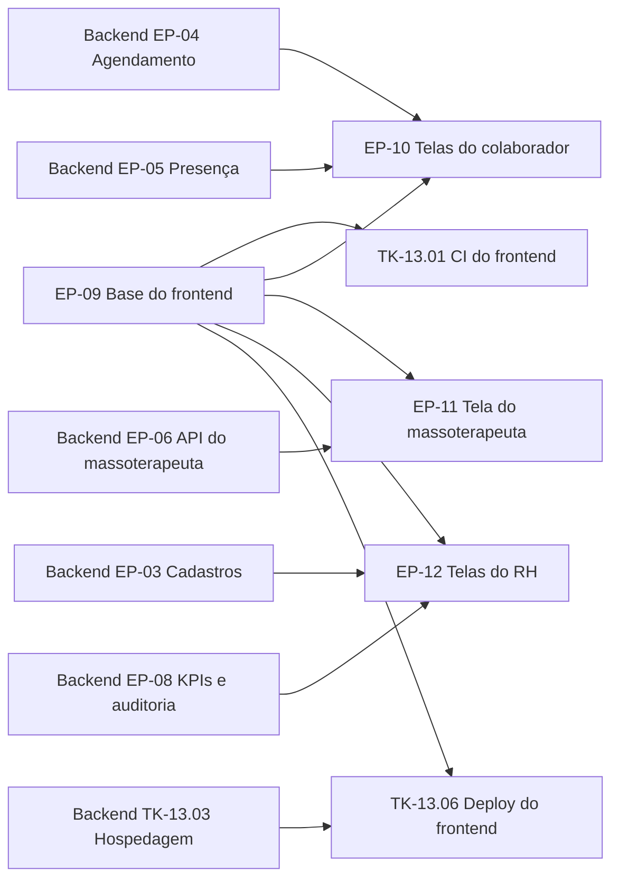

# Roadmap do frontend

Criado em 2026-10-27. Complementa o `backend/docs/requisitos.md`, que define **o que** construir; este arquivo define **em que ordem**, **em que pedaços** e **com quem** no frontend. Todo o trabalho de frontend do projeto vive aqui: os épicos EP-09 a EP-12, a CI e o deploy do frontend (TK-13.01 e TK-13.06), além da interface do assistente no EP-15. O roadmap do backend (`backend/docs/roadmap.md`) cuida só do backend.

Os IDs de épicos, tickets e decisões são globais no repositório, para não haver dois EP-09 nem duas D-21. Se este arquivo e o `requisitos.md` divergirem, vale o `requisitos.md`.

## Acessibilidade visual em todo épico

**Acessibilidade é o requisito fulcral do frontend (D-23, 2026-10-27).** Nenhum épico deste roadmap está pronto sem acessibilidade visual impecável, e em conflito com estética, prazo ou funcionalidade, a acessibilidade vence. Todo ticket que toca a interface cumpre o `docs/acessibilidade.md`:

- **WCAG 2.2 AA em tudo + critérios AAA** (contraste 7:1, aparência do foco, foco não obscurecido, alvos de 44 × 44 px, prevenção de erros em todas as ações), **ABNT NBR 17225:2025**, **eMAG 3.1**, **LBI** (art. 63), **WAI-ARIA 1.2 / APG**, **AccName**, **HTML-AAM**, **W3C COGA**;
- todos os perfis de deficiência visual: cegueira, baixa visão, baixa sensibilidade ao contraste, daltonismo, fotofobia, campo visual reduzido, cores forçadas;
- testes automáticos (lint `jsx-a11y` strict, axe em todo teste de tela, axe em navegador real com contraste AAA, script de contraste dos tokens, testes de foco, anúncio e teclado);
- roteiro manual registrado no PR: teclado, NVDA + Chrome, zoom de 400%, alto contraste e `forced-colors`, simulação de daltonismo, movimento reduzido;
- validação com os massoterapeutas antes de fechar o EP-11 (TK-11.04) e no teste de usabilidade do M3 (TK-14.05, no roadmap do backend).

Os critérios de aceite de cada spec trazem **casos de acessibilidade** próprios (foco, anúncio, nome acessível, teclado, contraste, zoom, leitor de tela), além dos funcionais. Spec sem esses casos não vai para tickets.

## Como usar: spec → tickets → implement

```
Épico (EP-NN)  ──spec──▶  docs/specs/EP-NN-<nome>.md  ──tickets──▶  docs/tickets/EP-NN/TK-NN.MM-<slug>.md  ──implement──▶  PR
```

| Passo | Entrada | Saída | Pronto quando |
| --- | --- | --- | --- |
| **Spec** | Um épico deste arquivo + `requisitos.md` + `AGENTS.md` + `docs/acessibilidade.md` | `docs/specs/EP-NN-<nome>.md` | Rotas e telas, contratos da API usados, estados (carregando, vazio, erro), critérios de aceite em Dado/Quando/Então (funcionais **e** de acessibilidade) para cada ticket, segurança, nenhuma decisão 🔒 em aberto no escopo |
| **Tickets** | A spec do épico | Um arquivo por ticket (ver `docs/agents/issue-tracker.md`) | Cada ticket cabe num PR e tem critérios de aceite, dependências, arquivos prováveis e testes esperados |
| **Implement** | Um ticket | Commits na branch do épico (`<tipo>/EP-NN-<nome>`), PR, status atualizado | Definição de pronto do `AGENTS.md` e do `docs/acessibilidade.md` atendida |

Regras:

- **Uma branch por épico**, não por ticket: `feat/EP-09-base-do-frontend`, `feat/EP-11-tela-do-massoterapeuta`. Antes de commitar um ticket, confira se está na branch do épico dele.
- **Ticket 🔒 não vai para implement.** Resolva a decisão na tabela "Decisões pendentes" e registre no `backend/docs/requisitos.md`.
- **Um ticket por vez por pessoa**, respeitando a coluna "Depende de". Tickets sem dependência entre si podem rodar em paralelo.
- **Dependência de backend** (TK-03.xx a TK-08.xx) precisa estar ✅ no `backend/docs/roadmap.md` antes do implement. Se a tela precisa de algo que a API não tem, o pedido entra como ticket no roadmap do backend, nunca como contorno no frontend.
- **Cada ticket tem um responsável** (coluna "Responsável"). Trocar é combinado entre os dois e registrado aqui no mesmo PR.
- **Tamanho:** P (até meio dia), M (cerca de um dia), G (dois a três dias; se passar disso, divida na spec).
- **Commits e testes citam o ticket e os IDs de requisito:** `refactor(booking): TK-09.01 migrate booking steps to TypeScript`.
- **Ao terminar um ticket**, atualize o status aqui e no arquivo do ticket, no mesmo PR.

Legenda de status: ✅ feito · 🟡 existe código legado a refatorar · ⬜ a fazer · 🔒 bloqueado por decisão ou por ticket de backend

### Prompts sugeridos

**Spec**

```
Leia frontend/AGENTS.md, frontend/CONTEXT.md, frontend/docs/acessibilidade.md,
backend/docs/requisitos.md e o épico EP-NN em frontend/docs/roadmap.md.
Escreva frontend/docs/specs/EP-NN-<nome>.md com: objetivo, fora de escopo, telas e rotas,
contratos da API usados, estados (carregando, vazio, erro), critérios de aceite em
Dado/Quando/Então para cada ticket, casos de acessibilidade (foco, anúncio, nome acessível,
teclado, contraste, zoom, leitor de tela), segurança e perguntas em aberto.
Não implemente nada. Se encontrar uma decisão 🔒 ou um [PREENCHER] no escopo, pare e pergunte.
```

**Tickets**

```
A partir de frontend/docs/specs/EP-NN-<nome>.md, crie um ticket para cada TK-NN.MM do épico
em frontend/docs/tickets/EP-NN/, com: cabeçalho, contexto, critérios de aceite copiados da spec
(inclusive os de acessibilidade), arquivos prováveis, testes esperados, dependências e tamanho.
```

**Implement**

```
Implemente o TK-NN.MM seguindo frontend/AGENTS.md, frontend/docs/acessibilidade.md e a spec do
épico: TDD, IDs nos nomes dos testes, commits na branch do épico. Ao final rode typecheck, lint,
test e build, faça o roteiro manual de acessibilidade e atualize o status no roadmap e no ticket.
```

## Visão geral

### Marcos

Os marcos M2 a M5 são os mesmos do roadmap do backend; aqui está a parte do frontend em cada um.

| Marco | O que dá para demonstrar no frontend | Épicos e tickets | Pronto quando |
| --- | --- | --- | --- |
| **F0 — Base sólida** | Frontend em TypeScript, organizado por funcionalidade, com CSP, fundação de acessibilidade, testes em navegador real e CI | EP-09, TK-13.01 | Todos os tickets do EP-09 ✅ e a CI do frontend bloqueando PR |
| **M2 — Colaborador agenda sozinho** | Reserva, cancelamento, lista de espera e check-in pela web | EP-10 | Colaborador faz o ciclo completo só com teclado e com NVDA |
| **M3 — Massoterapeuta autônomo** | Massoterapeuta passa o dia só com a tela e a Alexa, sem pedir informação a ninguém | EP-11 | TK-11.04 feito, com os massoterapeutas validando |
| **M4 — RH no controle** | Cadastros, agendas, bloqueios, parâmetros, pareamento, KPIs e auditoria | EP-12 | RH monta a semana e lê os KPIs sem ajuda |
| **M5 — Demonstração** | Frontend publicado com HTTPS e cabeçalhos de segurança, apontando para o backend publicado | TK-13.06 | Roteiro da demo (TK-13.05) passa no ambiente publicado |

### Dependências entre épicos



**Primeiro passo (decidido em 2026-10-27):** o EP-09. Organizar o frontend, aplicar as boas práticas de segurança e migrar para TypeScript **antes** de qualquer tela nova. Telas que já existem (EP-10) só são retomadas na base nova.

### O que o frontend precisa do backend

Situação em 2026-10-27, conferida no `backend/docs/roadmap.md`.

| Épico do frontend | Tickets de backend | Situação |
| --- | --- | --- |
| EP-09 | TK-02.02 (`GET /me`), TK-02.03 (usuários de demonstração) | ✅ |
| EP-10 | TK-04.01 a TK-04.06, TK-04.09, TK-04.10, TK-03.10, TK-05.02 | ✅ |
| EP-11 | TK-06.02 a TK-06.07 | ✅ |
| EP-12 | TK-03.01 a TK-03.08, TK-08.02, TK-08.03 | ✅ |
| TK-13.06 | TK-13.03 (hospedagem do backend) | ⬜ |

## Divisão do trabalho

A mesma divisão do projeto: por área do domínio, não por camada. Quem lidera o épico escreve a spec; os tickets podem ter o outro como responsável.

| Pessoa | Área no frontend | Épicos que lidera |
| --- | --- | --- |
| **Guilherme** | Base acessível, segurança, tudo o que o massoterapeuta toca, CI e deploy | EP-09, EP-11, TK-13.01, TK-13.06 |
| **Mariana** | Jornadas do colaborador e do RH | EP-10, EP-12 |

**Por que assim:** o massoterapeuta é o usuário principal, e a mesma pessoa que cuida da Alexa e da API dele (backend EP-06 e EP-07) cuida da base acessível (EP-09) e da tela dele (EP-11). Uma pessoa só decide como ele ouve e lê a informação. Os componentes de `shared/a11y` e `shared/ui` nascem no EP-09 e são usados por todos os épicos.

Carga estimada (P = 0,5 · M = 1 · G = 2,5 dias): **Guilherme ≈ 20 dias** (EP-09 ≈ 10,5; EP-11 ≈ 5,5; TK-12.01 e TK-12.06 ≈ 1,5; TK-13.01 e TK-13.06 ≈ 1,5; mais revisões de acessibilidade das telas da Mariana) e **Mariana ≈ 16,5 dias** (EP-10 ≈ 6,5; EP-12 ≈ 10).

### Ordem sugerida

**Guilherme**

1. TK-09.07 e TK-09.01 (sem dependência entre si) → TK-09.09 → TK-09.02
2. TK-09.05 e TK-09.06 → TK-09.03 → TK-09.04 (desbloqueia a Mariana)
3. TK-09.08 → TK-13.01 → TK-09.10
4. TK-11.01 → TK-11.03 → TK-11.02 → TK-11.04 (com os massoterapeutas)
5. TK-12.01, TK-12.06
6. TK-13.06, depois do TK-13.03 do backend

**Mariana**

1. Revisar a spec do EP-09 e escrever as specs do EP-10 e do EP-12 enquanto o EP-09 anda
2. Depois do TK-09.04: TK-10.05 → TK-10.01 (landing page) → TK-10.03 → TK-10.02 (depois do TK-04.10 do backend) → TK-10.04 (depois do TK-04.09 do backend)
3. TK-12.02 → TK-12.03 → TK-12.04 → TK-12.05 → TK-12.08 → TK-12.07

### Regras de convivência

- **O EP-09 vem antes.** Ninguém começa tela nova nem refatora tela existente antes do TK-09.04; a reorganização de pastas (TK-09.02) mexe em todos os arquivos.
- **Rebase no mesmo dia** em que o TK-09.01 e o TK-09.02 entrarem na `main`.
- **Componentes compartilhados** (`shared/a11y`, `shared/ui`, tokens de tema): quem precisar mudar um deles avisa na revisão e adiciona teste; mudança de token passa no `check:contrast`.
- **Contratos com o backend** são combinados na spec, antes do código. Esquema Zod que não bate com a resposta real é bug de contrato: corrige-se no lado errado, com teste dos dois lados.
- **Revisão cruzada.** Todo PR é revisado pela outra pessoa. PRs que tocam tela do massoterapeuta ou componente compartilhado têm revisão de acessibilidade do Guilherme.
- **Arquivos compartilhados** (este roadmap, `app/routes.tsx`, `shared/api/schemas.ts`): cada um acrescenta na sua seção; conflito se resolve no rebase.

## Decisões

IDs continuam a numeração do `backend/docs/roadmap.md`. Toda decisão é registrada no `backend/docs/requisitos.md` (tabela "Decisões registradas"); ao decidir, troque 🔒 por ⬜ nos tickets.

### Registradas

| ID | Decisão | Data | Afeta |
| --- | --- | --- | --- |
| D-23 | **Acessibilidade é o requisito fulcral do frontend.** Nenhuma tela é entregue sem acessibilidade visual impecável: WCAG 2.2 AA em tudo + critérios AAA, ABNT NBR 17225:2025, eMAG 3.1, LBI (art. 63), WAI-ARIA 1.2 e APG (`docs/acessibilidade.md`). Em conflito com estética, prazo ou funcionalidade, **a acessibilidade vence**. RN-04 atualizado no `requisitos.md` | 2026-10-27 | Todo o frontend |
| D-10 | Biblioteca de UI: **React Aria Components** (padrões do APG prontos); shadcn/ui com Radix descartado | 2026-10-27 | TK-09.01, todos os componentes interativos |
| D-17 | **Monorepo:** frontend e backend no mesmo repositório, em `frontend/` e `backend/`, cada um com a própria documentação e o próprio roadmap | 2026-10-27 | Todo o projeto |
| — | **TypeScript strict** no frontend, migrado no EP-09 | 2026-10-27 | TK-09.01 |
| D-21 | Roteador: **React Router** | 2026-10-27 | TK-09.04 |
| D-22 | Validação das respostas da API: **Zod**, a mais usada no ecossistema TypeScript; o esquema gera o tipo e a validação | 2026-10-27 | TK-09.03 |
| D-24 | **A cena 3D do hero (`LogoWire`) fica**: decorativa (`aria-hidden`), desligada com "reduzir movimento", com botão de pausar (2.2.2). O `Diamond.jsx` (outra cena, guardada sem uso) é removido | 2026-10-27 | TK-09.06, TK-09.09 |
| D-27 | **Página inicial como landing page:** um `h1` claro, a cena 3D do hero como fundo decorativo e destinos como links reais (`<a href>`): reservar, suas sessões, a tela do papel de quem entrou e a página de acessibilidade. Cada destino é uma rota com título e foco próprios, em vez de uma página longa | 2026-10-27 | TK-09.04, TK-10.01 a TK-10.04 |
| D-28 | **Tela do massoterapeuta como PWA instalável no MVP:** manifesto e ícones, abre direto na agenda e sem a barra do navegador; sem service worker de push (Web Push segue fora do MVP) | 2026-10-27 | TK-11.05 |
| D-25 | **Fontes hospedadas junto do site** (pacotes `@fontsource`), sem Google Fonts em tempo de execução: CSP estrita, sem enviar o IP do visitante a terceiros (LGPD) | 2026-10-27 | TK-09.07 |
| D-26 | Testes em navegador real com **Playwright + `@axe-core/playwright`** | 2026-10-27 | TK-09.08, TK-13.01 |
| D-07 | Avisos à tela do massoterapeuta por **consulta periódica** (`GET /notifications` com `since`), sem SSE no protótipo | 2026-10-26 | TK-11.03 |
| D-09 | **Frontend hospedado na Vercel**; backend em contêiner sempre ligado | 2026-10-23 | TK-13.06 |
| D-12 | Identificação do protótipo pela tela **"Entrar como…"** (`GET /auth/demo-users`, cabeçalho `x-user-id`) | 2026-10-20 | TK-09.03, TK-09.04 |

### Pendentes

Nenhuma em 2026-10-27. Decisão nova entra aqui com a numeração seguinte (D-29 em diante), no formato: ID, decisão, o que bloqueia, sugestão, quem cobra.

### Dependem do produto (EP-14, no roadmap do backend)

| Questão | Afeta | Ticket |
| --- | --- | --- |
| Qual leitor de tela e aparelho os massoterapeutas usam? (`[PREENCHER]` no `requisitos.md`) | Matriz obrigatória de testes de todo PR | TK-14.01 |
| Frases e respostas validadas com os massoterapeutas | Textos da tela do massoterapeuta | TK-14.03 |

## Épicos e tickets

### EP-09 — Base do frontend: organização, segurança e TypeScript (FE)

**Lidera:** Guilherme · **Spec:** `docs/specs/EP-09-base-do-frontend.md` ✅ · **Tickets:** `docs/tickets/EP-09/` ✅ · **Branch:** `feat/EP-09-base-do-frontend`

O comportamento atual (tela do colaborador, check-in, "Entrar como…") e os testes que passam hoje são preservados.

| Ticket | Descrição | Requisitos | Depende de | Tam. | Responsável | Status |
| --- | --- | --- | --- | --- | --- | --- |
| TK-09.01 | Migrar para TypeScript strict (`tsconfig`, `vite.config.ts`, `typecheck`, sem `any`), mantendo o comportamento e os testes | RN-04 | — | M | Guilherme | ✅ |
| TK-09.02 | Estrutura por funcionalidade (`app/`, `features/`, `shared/`) e alias `@/` | — | TK-09.01 | M | Guilherme | ✅ |
| TK-09.03 | Cliente da API tipado: contratos espelhando os DTOs, `ApiError`, validação das respostas com Zod (D-22), identificação isolada em `features/auth` | RNF-04 | TK-09.02 | M | Guilherme | ✅ |
| TK-09.04 | Roteamento por papel com React Router (D-21): rotas, `/check-in/:token` validado, título e foco no `h1` a cada rota | RNF-01 | TK-09.03 | M | Guilherme | ✅ |
| TK-09.05 | Fundação de acessibilidade em `shared/a11y`: `Announcer`, foco gerenciado, `SkipLinks`, `VisuallyHidden`, `usePageTitle`, `ConfirmDialog` | RNF-01, RN-04, RN-13 | TK-09.02 | M | Guilherme | ✅ |
| TK-09.06 | Tokens visuais acessíveis: contraste 7:1, foco 2.4.13, `forced-colors`, `prefers-contrast`, reflow a 400%, espaçamento de texto, alvos de 44 px, botão de pausar a cena 3D (D-24) e script `check:contrast` | RN-04 | TK-09.02 | G | Guilherme | ✅ |
| TK-09.07 | Segurança: CSP e cabeçalhos no `vercel.json`, script inline fora do `index.html`, fontes hospedadas (D-25), lint contra HTML injetado, política de `localStorage`, build sem source maps | RNF-04 | TK-09.01 | M | Guilherme | ✅ |
| TK-09.08 | Testes de acessibilidade em navegador real: Playwright + axe (D-26, AA e AAA), por tema, zoom de 400%, `forced-colors` e movimento reduzido; roteiro manual no modelo de PR | RN-04, RNF-01 | TK-09.04, TK-09.06 | M | Guilherme | 🟡 |
| TK-09.09 | Qualidade: Prettier, `typescript-eslint`, `react/no-danger`, scripts `format` e `typecheck`; remover comentários e código morto, incluindo o `Diamond.jsx` (D-24) | — | TK-09.01 | P | Guilherme | ✅ |
| TK-09.10 | Página "Acessibilidade" (eMAG): recursos, atalhos, temas, leitores testados e como relatar um problema | RN-04 | TK-09.04, TK-09.05 | P | Guilherme | ✅ |

### EP-10 — Telas do colaborador (FE)

**Lidera:** Mariana · **Spec:** `docs/specs/EP-10-telas-do-colaborador.md` · **Branch:** `feat/EP-10-telas-do-colaborador`

O código de 10.01, 10.02, 10.03 e 10.05 já existe (veio do `reservas-massagem`) e funciona; no EP-10 ele passa para a base do EP-09 e ganha os casos de acessibilidade que faltam.

**A spec deve cobrir:**
- a landing page (D-27): `h1` claro, destinos como links reais com nomes que dizem sozinhos para onde levam (2.4.9), o card da próxima sessão como frase completa e a cena 3D só como fundo (`aria-hidden`, texto sobre fundo sólido com 7:1, botão de pausar);
- reserva e suas sessões como rotas próprias, cada uma com título e foco no `h1`;
- a reserva em etapas (unidade, massoterapeuta, dia, horário, confirmação) como grupos de rádio do React Aria, com a lista de horários como caminho acessível e a barra do dia só visual (`aria-hidden`);
- cada horário e cada sessão como frase completa ("terça, 28 de outubro, 14h, com Carla, sala 2");
- o resultado de reservar, cancelar e fazer check-in anunciado com o `spokenText` do backend;
- cancelamento com confirmação (RN-13) e foco depois que a sessão sai da lista;
- a oferta da lista de espera com o prazo em texto ("a vaga fica reservada até 14h10"), sem contagem regressiva anunciada (2.2.1);
- a página de check-in usável com o celular em uma mão, com alvos grandes e sem depender de câmera dentro do site;
- erros do backend (antecedência mínima, limite de reservas, horário ocupado) mostrados perto da ação e anunciados.

| Ticket | Descrição | Requisitos | Depende de | Tam. | Responsável | Status |
| --- | --- | --- | --- | --- | --- | --- |
| TK-10.01 | Landing page (D-27): `h1`, cena 3D decorativa, card da próxima sessão e links para reservar, sessões, perfil e acessibilidade | RF-09 | TK-09.04, TK-09.06, TK-04.05 | M | Mariana | 🟡 |
| TK-10.02 | Horários disponíveis e reserva; a barra do dia é só visual, a lista de horários é o caminho acessível; duração lida da API, sem descoberta por tentativa | RF-01, RF-02 | TK-09.04, TK-04.02, TK-04.10, TK-03.10 | G | Mariana | 🟡 NVDA manual pendente |
| TK-10.03 | Suas sessões e cancelamento com confirmação | RF-07, RF-03 | TK-09.05, TK-04.04 | M | Mariana | 🟡 roteiro manual de acessibilidade pendente |
| TK-10.04 | Oferecer lista de espera para periodos ocupados e apos conflito; consultar entradas, sair, aceitar e recusar ofertas em Suas sessoes | RF-04, RN-10 | TK-10.02, TK-10.03, TK-04.06, TK-04.09 | M | Mariana | 🟡 NVDA manual pendente |
| TK-10.05 | Página de check-in aberta pelo QR Code da sala | RF-06 | TK-09.04, TK-05.02 | M | Mariana | 🟡 NVDA manual pendente |

TK-10.01: landing, card, estado vazio/erro, destinos e rota de perfil implementados. `typecheck`, `lint`, `test` (137 testes), `build`, contraste e 36 verificações Playwright de acessibilidade passaram. Status permanece 🟡 até concluir a verificação manual com NVDA e Chrome/Firefox.

TK-10.03: `/sessions` separa agendamentos futuros ativos do historico; status finais, inclusive cancelamentos com data futura, nao contam como proximos. Testes backend `my-appointments.e2e-spec.ts` (2) passaram; frontend typecheck, lint, build e 64 testes focados passaram. Roteiro manual de acessibilidade ainda pendente.

TK-10.04: periodos ocupados para espera aparecem no mesmo seletor de horarios com identificacao `Indisponivel`; seleciona-los abre confirmacao sem secao separada. Typecheck, lint, build, contraste e 64 testes frontend focados passaram; 16 e2e backend da lista de espera passaram. NVDA manual ainda pendente.

TK-10.05: check-in pela rota do QR Code com POST sem body, token validado antes do envio, resposta `spokenText` anunciada, prevenção de reenvio durante a requisição e foco movido ao erro impeditivo. `typecheck`, `lint`, `test` (152 testes), `build`, contraste e 18 cenários Playwright de acessibilidade passaram. NVDA + Chrome/Firefox manual pendente; status permanece 🟡.

### EP-11 — Tela do massoterapeuta (FE)

**Lidera:** Guilherme · **Spec:** `docs/specs/EP-11-tela-do-massoterapeuta.md` (a escrever) · **Branch:** `feat/EP-11-tela-do-massoterapeuta`

O usuário principal: a seção "Regras específicas da tela do massoterapeuta" do `docs/acessibilidade.md` vale inteira. Consome as rotas `/therapists/me/*` e `/notifications` do backend (spec do EP-06 do backend).

**A spec deve cobrir:**
- as regiões fixas (Agora, Próximo, Agenda de hoje, Ações, Avisos), cada uma com cabeçalho e atalho de pulo, sempre na mesma ordem;
- agenda em lista cronológica, nunca em grade; cada item uma frase completa ("14h, Ana, sala 2, confirmada"), só com o primeiro nome do colaborador;
- `aria-live` para avisos, com histórico consultável, marcação de lido e sem interromper a leitura; urgência (`assertive`) só para mudança no atendimento atual ou no próximo;
- consulta periódica (D-07) que não move o foco nem reordena o que está sendo lido;
- confirmação antes de cancelar, bloquear e marcar ausência, com o foco em "Voltar" e o resultado anunciado; iniciar e finalizar executam direto e dizem o resultado (decisão de 2026-10-22);
- testes com a tela desligada no NVDA e no TalkBack, e com os próprios massoterapeutas.

| Ticket | Descrição | Requisitos | Depende de | Tam. | Responsável | Status |
| --- | --- | --- | --- | --- | --- | --- |
| TK-11.01 | Regiões Agora, Próximo e Agenda de hoje, com atalhos de pulo | RF-30, RF-10, RF-11, RF-15 | TK-09.05, TK-06.02 | M | Guilherme | 🟡 Implementado; testes e Playwright 18/18; NVDA/TalkBack manual pendente |
| TK-11.02 | Ações: iniciar e finalizar (sem confirmação); cancelar, bloquear com prévia e marcar ausência (com confirmação) | RF-32, RF-33, RF-12, RF-13, RF-14, RN-13 | TK-11.01, TK-06.03, TK-06.05, TK-06.06, TK-06.07 | G | Guilherme | 🟡 Implementado; 265 testes e Playwright 19/19; NVDA/TalkBack manual pendente |
| TK-11.03 | Avisos em tempo real com `aria-live`, histórico e marcação de lido | RF-31 | TK-11.01, TK-06.04 | M | Guilherme | 🟡 Implementado; 274 testes e Playwright 19/19; contraste 38/38 pares; NVDA/TalkBack e intervalo pendentes |
| TK-11.04 | Teste com a matriz completa de leitores de tela e sessão de validação com os massoterapeutas | RNF-01 | TK-11.01 a TK-11.03 | M | Guilherme | 🟡 Matriz automatizada Chromium 21/21; leitores de tela e sessão com massoterapeutas pendentes |
| TK-11.05 | PWA instalável da tela do massoterapeuta (D-28): manifesto com nome e `short_name` em português, ícones, `start_url` na agenda, sem service worker de push | RNF-01 | TK-11.01 | P | Guilherme | 🟡 Manifesto/ícones implementados; Playwright 19/19; instalação pelo sistema e leitor de tela pendentes |

### EP-12 — Telas do RH (FE)

**Lidera:** Mariana · **Spec:** `docs/specs/EP-12-telas-do-rh.md` · **Branch:** `feat/EP-12-telas-do-rh`

Também serve ao suporte (`ADMIN`), que herda tudo do RH.

**A spec deve cobrir:**
- tabelas de dados com `<caption>`, `<th scope>` e ordenação anunciada, com versão em lista a 320 px;
- formulários com rótulo visível, erros do backend ligados ao campo e resumo de erros com foco;
- a montagem da agenda (TK-12.03) sem depender de arrastar: tudo por formulário e teclado;
- conflitos devolvidos pelo backend (D-04: bloqueio sobre atendimento marcado) listados em texto, com o que fazer;
- KPIs com tabela de dados equivalente e resumo em texto ao lado de cada gráfico (cores validadas para daltonismo);
- QR Code da sala impresso com o nome da sala e a instrução de uso em texto;
- código de pareamento da Alexa mostrado e anunciado dígito a dígito, com a validade em texto;
- auditoria com filtros e paginação acessíveis (página atual anunciada, foco no início dos resultados).

| Ticket | Descrição | Requisitos | Depende de | Tam. | Responsável | Status |
| --- | --- | --- | --- | --- | --- | --- |
| TK-12.01 | Usuários: listar, criar, ativar e desativar | RF-20 | TK-09.04, TK-03.01 | M | Guilherme | 🟡 NVDA manual pendente |
| TK-12.02 | Unidades e salas, com impressão do QR Code | RF-24 | TK-09.04, TK-03.02 | M | Mariana | 🟡 NVDA manual pendente |
| TK-12.03 | Montagem da agenda diária dos massoterapeutas, com cópia de um dia modelo | RF-25, RF-26 | TK-09.04, TK-03.03, TK-03.04, TK-03.05 | G | Mariana | 🟡 NVDA manual pendente |
| TK-12.04 | Bloqueios de horário | RF-23 | TK-09.04, TK-03.06 | P | Mariana | 🟡 NVDA manual pendente |
| TK-12.05 | Parâmetros das regras de negócio | RF-27 | TK-09.04, TK-03.07 | M | Mariana | 🟡 NVDA manual pendente |
| TK-12.06 | Código de pareamento da Alexa | RF-17 | TK-09.04, TK-03.08 | P | Guilherme | 🟡 NVDA manual pendente |
| TK-12.07 | Dashboard de KPIs | RF-21 | TK-09.04, TK-08.02 | G | Mariana | 🟡 NVDA manual pendente |
| TK-12.08 | Auditoria | RF-22 | TK-09.04, TK-08.03 | M | Mariana | 🟡 NVDA manual pendente |

TK-12.01: `/hr/users` lista e filtra usuários via API, cadastra com confirmação, cria perfis de massoterapeuta pelo contrato do backend e confirma ativação/desativação. `typecheck`, `lint`, `test` (160 testes), `build`, contraste (38 pares em 7 temas) e 18 verificações Playwright de acessibilidade passaram. NVDA + Chrome/Firefox e simulação manual de daltonismo não foram executados porque esta sessão não disponibilizou navegador nem leitor de tela; o status permanece 🟡 até concluir esse roteiro.

TK-12.02: `/hr/locations` consulta unidades por `GET /locations/admin` e lista/filtra salas por unidade/status via `GET /rooms`; permite criar sala em unidade ativa, gerar QR local com `qrcode.react` para `/check-in/:token`, regenerar somente após confirmação e imprimir QR com nome, unidade e instrução textual. O token não é enviado a terceiros nem exposto como texto. `GET /locations/admin` exige RH; `GET /locations` de colaborador permanece inalterado. Frontend typecheck, lint, build, contraste, Prettier e 173 testes Vitest passaram; backend lint/build e 580 unitários + 6 e2e de unidades passaram. Os 18 cenários Playwright da tela passaram; a suíte global ficou em 180/181 por falha do TK-09.08, reproduzida isoladamente, que não detecta animação na página inicial. Roteiro manual com NVDA e daltonismo pendente por falta de leitor de tela interativo nesta sessão.

TK-12.03: `/hr/schedules` permite consultar períodos por data/unidade/massoterapeuta/sala, criar/editar/remover com revisão e confirmação, mostra conflitos com atendimentos e copia uma agenda para datas futuras escolhidas (limite de 31), exibindo resultados parciais por data. Typecheck, lint, build, Prettier, contraste (38 pares em 7 temas) e 196 testes Vitest passaram; após o último ajuste, 33 testes focados passaram. Os 18 cenários Playwright da tela passaram, cobrindo axe nos temas claro/escuro/alto contraste, teclado e ordem do foco, 320 px/zoom de 400%, cores forçadas e movimento reduzido. NVDA + Chrome/Firefox, daltonismo manual e revisão manual de teclado/zoom/contraste não foram executados nesta sessão; o status permanece 🟡 até concluir esse roteiro.

TK-12.04: `/hr/blocks` cria bloqueio pontual após revisão e confirmação, usa somente `POST /schedule-blocks`, explica erros do catálogo e lista os atendimentos conflitantes do D-04 sem cancelá-los. A tela não consulta, edita nem remove bloqueios existentes. Typecheck, lint, build, contraste (38 pares em 7 temas), testes Vitest (204) e 18 cenários Playwright da rota passaram. NVDA + Chrome/Firefox, daltonismo manual e revisão manual de teclado/zoom/contraste não foram executados nesta sessão; o status permanece 🟡 até concluir esse roteiro.

TK-12.05: `/hr/rules` consulta `GET /business-rules` e permite editar uma configuração por vez com controle apropriado ao tipo, resumo dos valores atual/proposto e confirmação antes de `PATCH /business-rules/:key`. Valor exibido só muda após resposta da API; erros de validação mantêm o valor salvo, focam o resumo e se associam ao campo. A interface mostra nomes, descrições e valores formatados, sem chaves, tipos ou códigos internos; os valores são marcados como provisórios. Typecheck, lint, build, contraste (38 pares em 7 temas), Prettier direcionado e 213 testes Vitest passaram. Os 18 cenários Playwright da rota passaram, cobrindo axe nos três temas, teclado/foco, zoom de 400%/320 px, cores forçadas e movimento reduzido. NVDA + Chrome/Firefox e simulação manual de daltonismo não foram executados nesta sessão; o status permanece 🟡 até concluir essa validação.

TK-12.06: `/hr/alexa-pairing` consulta massoterapeutas ativos, exige confirmação e gera pelo `POST /therapists/:id/alexa-pairing-code`. Valida seis dígitos e `expiresAt`, apresenta cada dígito em item separado, anuncia código e validade pelo Announcer no fuso America/Sao_Paulo, e mantém o segredo apenas em memória; nova geração substitui a exibição anterior. Typecheck, lint, build, contraste (38 pares/7 temas), 222 testes Vitest e 18 verificações Playwright da tela passaram. NVDA + Chrome/Firefox e simulação manual de daltonismo pendentes por falta de leitor de tela interativo nesta sessão; status amarelo até concluir o roteiro.

TK-12.07: `/hr/reports` pré-seleciona e carrega o mês corrente em `America/Sao_Paulo`; setas consultam automaticamente os meses adjacentes. Filtros opcionais de unidade, massoterapeuta e granularidade ficam recolhidos e são aplicados sob demanda. `GET /reports/kpis` recebe `from`/`to` nos limites do mês. Quatro indicadores mostram valores de destaque; cada expansão abre um gráfico de linha compacto e a tabela equivalente fica em um segundo controle. Resultados e regras (zeros, ordem, desempate, taxa e fuso) vêm da API; o `spokenText` é exibido e anunciado literalmente. Typecheck, lint, build, contraste (38 pares/7 temas), 237 testes Vitest, Prettier direcionado e 18 cenários Playwright da rota passaram. NVDA + Chrome/Firefox e simulação manual de daltonismo pendentes por falta de leitor de tela interativo nesta sessão; status amarelo até concluir o roteiro.

### EP-13 (parte do frontend) — CI e deploy (INF)

**Lidera:** Guilherme. Os demais tickets do EP-13 (túnel da Alexa, hospedagem do backend, deploy do backend, dados da demo) estão no roadmap do backend.

| Ticket | Descrição | Requisitos | Depende de | Tam. | Responsável | Status |
| --- | --- | --- | --- | --- | --- | --- |
| TK-13.01 | `.github/workflows/frontend-ci.yml`: `npm ci`, `typecheck`, `lint`, `format:check`, `test`, `check:contrast`, `test:a11y`, `build` e `npm audit --audit-level=high` a cada PR que toca `frontend/` | RN-04 | TK-09.08, TK-09.09 | P | Guilherme | ⬜ |
| TK-13.06 | Deploy do frontend na Vercel (D-09): pré-visualização por PR, produção a cada merge na `main`, `VITE_API_URL` e `connect-src` da CSP apontando para o backend publicado, cabeçalhos de segurança conferidos | — | TK-13.01, TK-09.07, TK-13.03 | M | Guilherme | ⬜ |

### EP-15 — Assistente informativo com RAG (BE + FE)

**Lidera:** Guilherme · **Spec:** `docs/specs/EP-15-assistente-informativo-rag.md` · **Tickets:** `docs/tickets/EP-15/` e `../../backend/docs/tickets/EP-15/`

O assistente responde perguntas sobre o sistema com base nos documentos oficiais, apresenta as fontes e não executa operações. Os tickets do serviço RAG e da API NestJS estão no roadmap do backend; os tickets de interface e validação ficam aqui. A prioridade do RF-34 continua em aberto.

| Ticket | Descrição | Requisitos | Depende de | Tam. | Responsável | Status |
| --- | --- | --- | --- | --- | --- | --- |
| TK-15.03 | Interface pública `/chat`: enviar pergunta, apresentar resposta, fontes, sugestões, carregamento, erro e nova tentativa; respeitar privacidade e acessibilidade | RF-34, RN-04, RNF-04 | TK-15.02, TK-09.04, TK-09.05 | M | Guilherme | 🟡 |
| TK-15.04 | Cobertura automatizada e validação integrada do assistente: API + RAG + conversa acessível em navegador, configuração e limites operacionais documentados | RF-34, RN-04, RNF-04 | TK-15.01, TK-15.02, TK-15.03 | M | Guilherme | 🟡 |

TK-15.03: testes de componente e 20 cenários Playwright passaram; roteiro manual com NVDA/TalkBack pendente. TK-15.04: teste real FastAPI + Ollama + NestJS passou com `qwen2.5:1.5b` para regra pendente, informação documentada e pergunta sem resposta; a pergunta sobre cancelamento que antes gerava prazo falso agora retorna pendência determinística. Com Mistral, a resposta fria levou 50,3 s e a repetição aquecida pela API 9,5 s. A validação operacional sob carga e no deploy e o roteiro manual de acessibilidade ainda estão pendentes; detalhes em `backend/docs/chat-rag-validacao.md`.

### EP-16 — Pesquisa de satisfação (FE)

**Lidera:** Mariana · **Spec:** `docs/specs/EP-16-pesquisa-de-satisfacao.md`

A pesquisa fica em Suas sessões quando houver pelo menos um atendimento concluído. Resultados não incluem identificadores de colaborador ou sessão.

| Ticket | Descrição | Requisitos | Depende de | Tam. | Responsável | Status |
| --- | --- | --- | --- | --- | --- | --- |
| TK-16.03 | Formulário acessível com as cinco perguntas e confirmação anônima de envio em Suas sessões | RF-34, RN-18, RN-04 | TK-10.03, backend TK-16.01 | M | Mariana | 🟡 |
| TK-16.04 | Página de resultados para RH com métricas agregadas e comentários sem metadados | RF-34, RN-18, RN-04 | TK-12.07, backend TK-16.02 | M | Mariana | 🟡 |

TK-16.03: questionário anônimo exibido após sessão concluída, com validação, retry, anúncio de sucesso e payload sem identificadores. Typecheck, lint, 282 testes, build, contraste (40 pares em 7 temas) e 293 cenários Playwright de acessibilidade passaram. O roteiro manual com NVDA + Chrome e conferência manual visual ainda está pendente neste ambiente; status amarelo até concluir.

TK-16.04: seção de resultados agregados anônimos integrada aos relatórios do RH, com distribuições, média de recomendação, comentários escapados e estados de carregamento, erro, vazio e retry. Typecheck, lint, 287 testes, build, contraste (40 pares em 7 temas) e 294 cenários Playwright de acessibilidade passaram. O roteiro manual com NVDA + Chrome e conferência visual manual permanece pendente neste ambiente; status amarelo até concluir.
### EP-15 — Assistente informativo com RAG (BE + FE)

**Lidera:** Guilherme · **Spec:** `docs/specs/EP-15-assistente-informativo-rag.md` · **Tickets:** `docs/tickets/EP-15/` e `../../backend/docs/tickets/EP-15/`

O assistente responde perguntas sobre o sistema com base nos documentos oficiais, apresenta as fontes e não executa operações. Os tickets do serviço RAG e da API NestJS estão no roadmap do backend; os tickets de interface e validação ficam aqui. A prioridade do RF-34 continua em aberto.

| Ticket | Descrição | Requisitos | Depende de | Tam. | Responsável | Status |
| --- | --- | --- | --- | --- | --- | --- |
| TK-15.03 | Interface pública `/chat`: enviar pergunta, apresentar resposta, fontes, sugestões, carregamento, erro e nova tentativa; respeitar privacidade e acessibilidade | RF-34, RN-04, RNF-04 | TK-15.02, TK-09.04, TK-09.05 | M | Guilherme | 🟡 |
| TK-15.04 | Cobertura automatizada e validação integrada do assistente: API + RAG + conversa acessível em navegador, configuração e limites operacionais documentados | RF-34, RN-04, RNF-04 | TK-15.01, TK-15.02, TK-15.03 | M | Guilherme | 🟡 |

TK-15.03: testes de componente e 20 cenários Playwright passaram; roteiro manual com NVDA/TalkBack pendente. TK-15.04: integração HTTP local simulada passou; smoke test com Ollama e roteiro manual pendentes.

## Riscos

| Risco | Impacto | Mitigação |
| --- | --- | --- |
| O leitor de tela dos massoterapeutas ainda é desconhecido (TK-14.01) | Testar na combinação errada e descobrir falhas na validação | Matriz completa no fim de cada épico; NVDA e TalkBack em todo PR do EP-11 até a resposta chegar |
| Paleta da marca não atinge 7:1 em todos os temas | Retrabalho visual | Script `check:contrast` no TK-09.06 antes de qualquer tela nova; a paleta se ajusta ao contraste (D-23) |
| Cena 3D pesada em computador reaproveitado da sala | Lentidão, leitor de tela atrasado | Cena só no hero, nunca na tela do massoterapeuta; pausável e desligada com "reduzir movimento" |
| Lacunas da API (TK-04.09, TK-04.10, TK-03.10) | Lista de espera e reserva sem o contrato certo | Pedidos registrados no roadmap do backend; a tela não contorna com regra duplicada |
| Migração e reorganização (TK-09.01, TK-09.02) quebram telas que funcionam | Regressão para o colaborador | Testes atuais preservados e convertidos; nenhuma tela nova antes do TK-09.04 |

## Fora do MVP (não iniciar sem pedido explícito)

| Item | Observação |
| --- | --- |
| Login com Google | Sessão em cookie `HttpOnly` definido pelo backend; tira a tela "Entrar como…" do build de produção |
| Web Push | Avisos ao massoterapeuta com a tela fechada; depende de inscrições no backend |
| Reagendamento pela tela | Fora do MVP (D-03): cancelar e reservar de novo |
